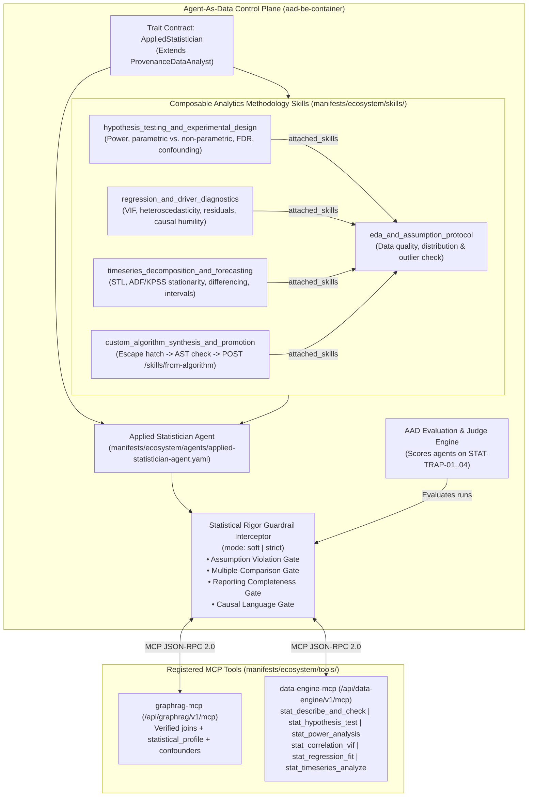

# Analytics Thinking Skills, AppliedStatistician Trait & Statistical Guardrails PRD

## Overview
This PRD defines how **Agent-As-Data (AAD)** encodes **analytics thinking, methodological rigor, and statistical guardrails** so autonomous agents operate like disciplined applied statisticians rather than naïve code generators.

Working alongside `data-engine`'s deterministic statistical toolbelt (`stat_*` MCP tools exposed via `data-engine-mcp`) and `Graphrag`'s persistent statistical metadata (`statistical_profile` & `known_confounders` exposed via `graphrag-mcp`), AAD governs:
1. The **`AppliedStatistician` Trait Contract** (extending `ProvenanceDataAnalyst`).
2. A **Composable Library of 5 Statistical Methodology Skills** packaged in the canonical `manifests/ecosystem/` pack (`manifests/ecosystem/traits/`, `manifests/ecosystem/skills/`, `manifests/ecosystem/agents/`) and hydrated declaratively via `aad-be ctl apply -f manifests/ecosystem -R --allow-degraded-tools` ([CLI Manifest & Hydration Tool PRD](./cli-manifest-tool-prd.md)).
3. **Configurable Statistical Guardrails** (`soft` warning mode by default; `strict` blocking mode opt-in per agent).
4. **Epistemic & Statistical Ablation Evaluation** against `data-engine`'s `STAT-TRAP-01`..`STAT-TRAP-04` benchmark suite.

### Architectural Rationale: Separating Analytics Thinking from Statistical Calculations
Delivering statistician-grade analytics requires separating two complementary disciplines across a **4-Layer Hybrid Statistician Stack**:
- **Layer 1 — Analytics Thinking & Guardrails (`agent-as-data`)**: LLMs excel at problem framing, domain synthesis, and methodological workflow selection when governed by explicit trait invariants and composable skills — yet they routinely skip assumption checks, ignore confounders, or over-interpret observational correlations unless structurally guided and guarded.
- **Layer 2 — Fast Data Reduction & Epistemic Memory (`data-engine` DataFusion + `Graphrag`)**: Rust/DataFusion handles SQL grain/fan-out validation, filtering, aggregation, and explicit seeded sampling at scale, while `Graphrag` preserves verified distributional traits (`is_heavy_tailed`, `seasonality_period`, `known_confounders`) across sessions.
- **Layer 3 — Governed Statistical Toolbelt (`data-engine` Scientific Python Sandbox)**: Deterministic, NIST-verified `scipy`/`statsmodels` algorithms pinned to immutable `code_sha256` digests execute over zero-copy `/dev/shm` Arrow IPC and return self-checking `assumption_checks` + `recommended_alternative` payloads (avoiding the numerical bugs of ad-hoc LLM-authored math scripts while retaining custom algorithm synthesis + `POST /skills/from-algorithm` promotion as an escape hatch).
- **Layer 4 — Visual Statistical Diagnostics (`de-fe-container` / `Angry-agent`)**: Bounded diagnostic chart specs (Q-Q, residual vs. fitted, distributions, CI forest bars, STL/ACF/forecast bands) mount into `./StatisticalDiagnosticsWrapper` alongside 1-click steward verification and provenance lineage.

---

## Architecture & Reasoning Flow



---

## Core Capabilities & Requirements

### 1. Built-In `AppliedStatistician` Trait Contract (`manifests/ecosystem/traits/`)
Extending `ProvenanceDataAnalyst` ([Data Semantic Stewardship & Provenance PRD](./data-semantic-stewardship-and-provenance-prd.md)), AAD defines the 3-element **`AppliedStatistician`** trait contract:

- **Capability Requirements**:
  - Read access to `graphrag-mcp` (`graphrag_find_join_path`, `graphrag_query`) to retrieve verified join paths, `statistical_profile` caveats, and known confounders.
  - Execution access to `data-engine-mcp`'s typed statistical MCP tools (`stat_describe_and_check`, `stat_hypothesis_test`, `stat_power_analysis`, `stat_correlation_vif`, `stat_regression_fit`, `stat_timeseries_analyze`) alongside `query_validate`, `query_execute`, `algorithm_add`, `algorithm_validate`, `algorithm_execute`, and `provenance_read`.
- **Behavioral Invariants**:
  1. *MUST ALWAYS* frame the estimand and run `stat_describe_and_check` (or inspect verified `statistical_profile` metadata from `graphrag-mcp`) before choosing a parametric test or regression family.
  2. *MUST ALWAYS* inspect `assumption_checks` returned by every `stat_*` tool; when parametric assumptions fail (e.g., normality, equal variance, stationarity, or homoscedasticity), *MUST* report and reason from the `recommended_alternative` (e.g., Mann-Whitney $U$, HC3 robust SEs, or first-differenced series).
  3. *MUST ALWAYS* report sample size ($n$), standardized effect size, confidence interval, and `provenance_run_id` alongside every $p$-value (never bare $p$-values).
  4. *MUST ALWAYS* check for potential confounders / stratification reversals (Simpson's paradox) when comparing groups across observational or imbalanced allocations.
  5. *MUST ALWAYS* apply multiple-comparison correction (e.g., Benjamini-Hochberg FDR or Holm-Bonferroni) when testing more than one hypothesis or subgroup segment in the same investigation.
  6. *MUST NEVER* assert causal claims from observational correlations or regressions without an explicit experimental design or causal identification strategy.
- **Evaluation Criteria**:
  - `100%` trap avoidance on `STAT-TRAP-01`..`STAT-TRAP-04` and zero missing provenance/effect-size disclosures in AAD Judge evaluations.

---

### 2. Declarative Analytics Methodology Skills & Agent (`manifests/ecosystem/`)
Phase 1 adds five curated, versioned declarative `Skill` manifests, the `AppliedStatistician` `Trait`, and the **`Applied Statistician Agent`** into the canonical `manifests/ecosystem/` pack (validated offline via `aad-be ctl validate -f manifests/ecosystem -R --self-contained`, hydrated via `make hydrate-ecosystem` / `aad-be ctl apply -f manifests/ecosystem -R --allow-degraded-tools`, and refreshed against live `data-engine` capabilities via `aad-be ctl sync-tools data-engine-mcp`):

| Skill `name` | `implements_traits` | `attached_skills` | `attached_tools` | Core Methodological Playbook |
| :--- | :--- | :--- | :--- | :--- |
| **`eda_and_assumption_protocol`** | `["AppliedStatistician"]` | `[]` | `["data-engine-mcp", "graphrag-mcp"]` | Checks grain, missingness patterns, skewness/kurtosis, normality, and outliers; explicitly recommends parametric vs. non-parametric or transformed workflows; checks `graphrag-mcp` for known field statistical traits. |
| **`hypothesis_testing_and_experimental_design`** | `["AppliedStatistician"]` | `["eda_and_assumption_protocol"]` | `["data-engine-mcp"]` | Guides estimand framing, prospective/retrospective power & MDE checks, automatic parametric vs. non-parametric selection, stratified confounding checks (Simpson's paradox), and FDR/Bonferroni correction across multi-segment tests. |
| **`regression_and_driver_diagnostics`** | `["AppliedStatistician"]` | `["eda_and_assumption_protocol"]` | `["data-engine-mcp"]` | Screens linear vs. monotonic correlations, checks VIF multicollinearity before fitting OLS/GLM/logistic/robust models, inspects Breusch-Pagan / Durbin-Watson / Cook's distance diagnostics, and enforces non-causal observational phrasing. |
| **`timeseries_decomposition_and_forecasting`** | `["AppliedStatistician"]` | `["eda_and_assumption_protocol"]` | `["data-engine-mcp"]` | Verifies timestamp regularity, runs STL decomposition and ADF/KPSS stationarity checks, requires differencing before cross-series correlation, surfaces changepoints/anomalies, and reports forecast prediction intervals. |
| **`custom_algorithm_synthesis_and_promotion`** | `["AppliedStatistician"]` | `["eda_and_assumption_protocol", "synthesize_and_run_sandbox_algorithm"]` | `["data-engine-mcp"]` | Escape hatch for specialized calculations not covered by built-in `stat_*` tools: authors AST-compliant Python using the scientific venv (`numpy`/`scipy`/`statsmodels`/`pyarrow`), dry-runs on a 100-row sample, executes with provenance, and guides steward promotion via `POST /skills/from-algorithm`. |

The **`Applied Statistician Agent`** implements `["AppliedStatistician", "ProvenanceDataAnalyst", "InteractiveCanvasCoEditor"]`, uses `["SemanticSteward"]`, attaches `["data-engine-mcp", "graphrag-mcp"]` and all five statistical skills plus `plan_semantic_join_path`, `audit_provenance_lineage`, and `coedit_shared_canvas_mfe`, and is composed into both `Epistemic Benchmark & Governance Agent` and `PolecatWorks Ecosystem Orchestrator Agent`. All hydrated entities automatically synchronize embeddings into `entity_embeddings` via BREAD endpoints.

---

### 3. Configurable Statistical Rigor Guardrails (`guardrail_config.statistical_rigor`)
AAD's pre-tool and outgoing guardrail interceptor ([Agent Registry & Execution PRD](./agent-registry-execution-prd.md)) is extended with a **Statistical Rigor Guardrail** configurable per agent via `guardrail_config.statistical_rigor`:

```json
{
  "enabled": true,
  "mode": "soft",
  "require_assumption_acknowledgement": true,
  "require_multiple_testing_correction_above": 1,
  "require_effect_size_and_ci": true,
  "flag_unverified_causal_language": true
}
```

- **Default Behavior (`mode: "soft"`)**: Never interrupts exploratory analysis; attaches structured `statistical_warnings` badges to the response metadata and surfaces them on the UI / RHS Shared Canvas so the user sees any methodological gaps immediately.
- **Strict Governance Mode (`mode: "strict"`)**: Forces a self-correction retry (or blocks final delivery with actionable feedback) if any active gate fails.

#### Four Deterministic Statistical Gates
1. **Assumption Violation Gate**: Inspects tool outputs in the current `thread_run` for `assumption_checks` with `status == "failed"`. Flags (or blocks in `strict` mode) final responses that report the failed parametric result without citing the `recommended_alternative` or addressing the failed assumption.
2. **Multiple-Comparison Gate**: Counts `stat_hypothesis_test` invocations (or multi-group/segment tests) within the current `thread_run`. When $m > \text{require\_multiple\_testing\_correction\_above}$ (default `1`) and no `adjustment_method` (`fdr_bh`, `holm`, `bonferroni`) was applied, flags/blocks potential $p$-hacking.
3. **Reporting Completeness Gate**: When a response cites a $p$-value or statistical significance claim, verifies that the backing `thread_run` invoked a `stat_*` or `algorithm_execute` tool and that the response discloses sample size ($n$), effect size, confidence interval, and `provenance_run_id`.
4. **Causal Language Gate**: When only observational correlation or standard regression (`stat_correlation_vif`, `stat_regression_fit`) was executed (no randomized experiment tag or Phase 2 causal estimator), flags causal phrasing (e.g., *"causes"*, *"drives"*, *"proves impact of"*) and suggests associative phrasing.

---

### 4. Statistical Ablation & Benchmark Evaluation (`STAT-TRAP-01`..`STAT-TRAP-04`)
Extending the 3-mode epistemic evaluation matrix ([Data Semantic Stewardship & Provenance PRD](./data-semantic-stewardship-and-provenance-prd.md)), AAD's evaluation bench scores agents across `data-engine`'s deterministic statistical traps:

| Evaluation Mode | Skills, Tools & Guardrails Active | Expected Outcome on `STAT-TRAP-01..04` |
| :--- | :--- | :--- |
| **Baseline Raw LLM** | SQL only; no `stat_*` tools, no `AppliedStatistician` skills, no statistical guardrails. | Falls for Simpson's paradox (`STAT-TRAP-01`), misreports outlier-skewed means (`STAT-TRAP-02`), cherry-picks spurious noise segment (`STAT-TRAP-03`), and reports $r > 0.85$ on independent random walks (`STAT-TRAP-04`). |
| **Statistical Toolbelt Only** | `data-engine-mcp` `stat_*` tools active, but no AAD methodology skills or statistical guardrails. | Correctly computes exact math and receives `assumption_checks`, but may forget to stratify (`STAT-TRAP-01`) or apply FDR across sequential calls (`STAT-TRAP-03`). |
| **Full 4-Layer Statistician Stack** | `AppliedStatistician` trait + composable skills (`manifests/ecosystem/`) + `data-engine-mcp` `stat_*` tools + `graphrag-mcp` statistical traits + Statistical Rigor Guardrails (`soft` / `strict`). | **`100%` trap avoidance** across `STAT-TRAP-01..04`, with complete effect sizes, confidence intervals, diagnostic plots, and immutable `provenance_run_id` chains. |

---

## Cross References
- [CLI Manifest & Hydration Tool PRD](./cli-manifest-tool-prd.md)
- [Data Semantic Stewardship, Algorithm Synthesis & Provenance PRD](./data-semantic-stewardship-and-provenance-prd.md)
- [Skills Registry & Tools PRD](./skills-registry-tools-prd.md)
- [Agent Registry & Execution PRD](./agent-registry-execution-prd.md)
- [Master PRD](./agent-as-data-prd.md)
