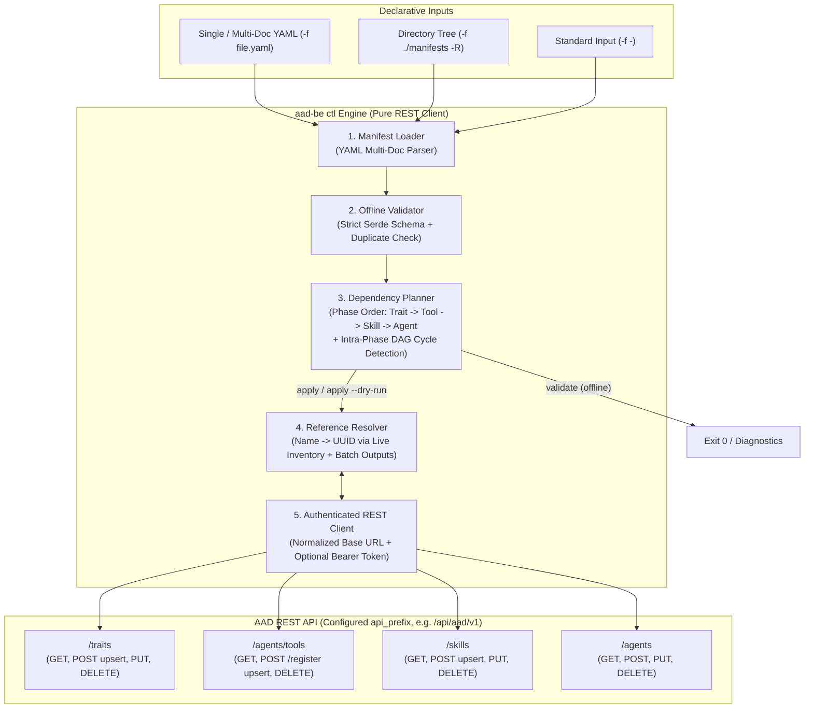
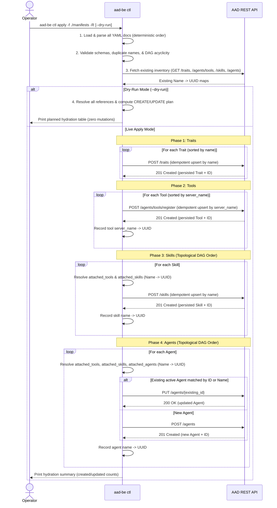
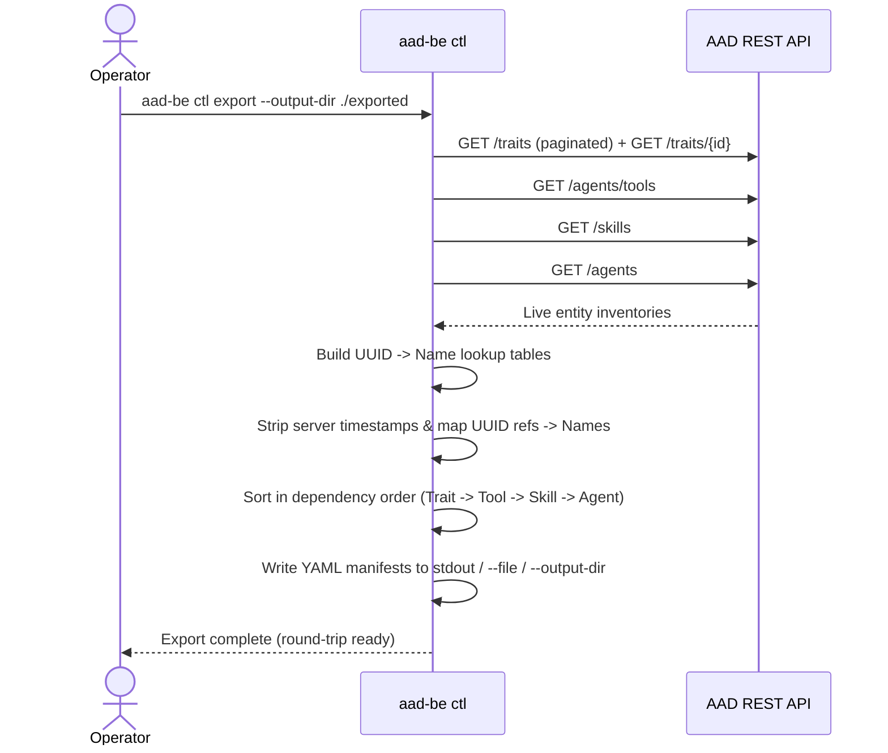
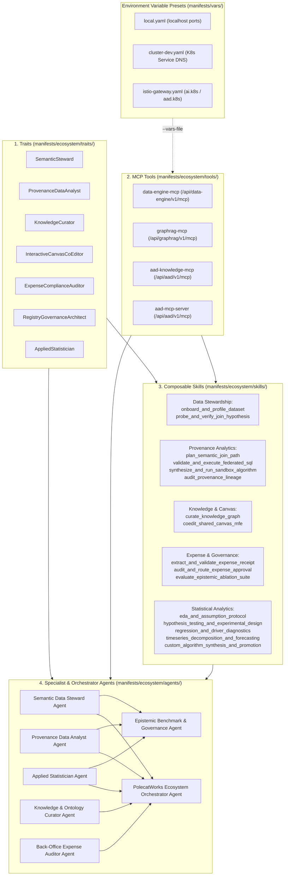

# CLI Manifest & Hydration Tool PRD (`aad-be ctl`)

## Overview

The CLI Manifest & Hydration Tool extends the `aad-be ctl` subcommand of the Agent-As-Data Backend binary (`aad-be`) into a declarative, GitOps-friendly CLI for hydrating, validating, inspecting, exporting, and deleting all four core registry resources in **Agent-As-Data (AAD)**:

- **Traits** (`Trait` -> `trait_contracts`)
- **Tools** (`Tool` -> `tools` / Remote MCP server registrations)
- **Skills** (`Skill` -> `skills`)
- **Agents** (`Agent` -> `agents`)

Modeled after `kubectl`, `aad-be ctl` enables developers, CI/CD pipelines, and platform operators to maintain declarative YAML definitions in Git and hydrate them idempotently into any local or remote AAD instance strictly through the AAD REST API—never via direct database access.

Related PRDs:
- [Master PRD](./agent-as-data-prd.md)
- [Agent Registry & Execution PRD](./agent-registry-execution-prd.md)
- [Skills Registry Tools PRD](./skills-registry-tools-prd.md)
- [Keycloak Claims & Service Auth PRD](./keycloak-claims-and-service-auth-prd.md)

---

## Objectives

1. **Full 4-Entity Registry Hydration**: Manage the full lifecycle (`apply`, `validate`, `get`, `delete`, `export`) of **Traits**, **Tools**, **Skills**, and **Agents** via declarative YAML manifests.
2. **Flexible Manifest Ingestion**: Support single YAML files, multi-document YAML streams (`---`), multiple `-f` flags, `stdin` (`-f -`), and directory trees (`-R` / `--recursive` with deterministic lexicographical ordering).
3. **Dependency-Ordered Hydration & Name-to-UUID Resolution**: Automatically hydrate resources in topological dependency order (`Trait` -> `Tool` -> `Skill` -> `Agent`, including DAG ordering for nested `attached_skills` and `attached_agents`) and resolve human-readable resource names (`attached_tools`, `attached_skills`, `attached_agents`) to persisted UUIDs—eliminating hardcoded UUIDs while maintaining backward compatibility with existing UUID-based manifests.
4. **Idempotent Upsert-by-Name**: Re-applying the same manifest set must converge cleanly without creating duplicate records or failing on conflicts across all four entity types (`Trait`, `Tool`, `Skill`, `Agent`).
5. **Pre-Flight Safety (`validate` & `--dry-run`)**: Support purely offline manifest validation (schema, duplicate names, DAG cycle detection, reference integrity) and `--dry-run` execution previews before mutating any live AAD state.
6. **Portable Round-Trip Export (`export`)**: Dehydrate live AAD resources back into portable, name-referenced YAML manifests (single multi-doc file, `stdout`, or structured directory tree) ready to hydrate into another environment.
7. **Standalone Remote Targeting & Auth**: Allow targeting any local or remote AAD endpoint via `--url` (or `AAD_CTL_URL`) without requiring backend server configuration files or database secrets, with Bearer JWT authentication (`--token`, `--token-file`, `AAD_CTL_TOKEN`) compatible with Keycloak-protected clusters.

---

## System Architecture & Hydration Pipeline



---

## CLI Command Surface

All CLI arguments MUST be parsed declaratively via `clap` derive macros (zero direct `std::env::var` reads in business logic).

### Global `ctl` Options

```text
aad-be ctl [OPTIONS] <COMMAND>
```

| Option | Env Alias (Clap) | Description |
| :--- | :--- | :--- |
| `--url <URL>` | `AAD_CTL_URL` | Full base URL of the AAD REST API including prefix (e.g., `http://localhost:8080/api/aad/v1` or `https://aad.dev.example.com/api/aad/v1`). When specified, `ctl` MUST NOT load server `AppConfig` or database secrets. When omitted, `ctl` falls back to loading `AppConfig` via `--config-path` / `--secrets-dir` and normalizes `http://{host}:{port}{api_prefix}` cleanly (no double slashes, no duplicate `/v1` segment). |
| `--token <JWT>` | `AAD_CTL_TOKEN` | Optional Bearer JWT sent as `Authorization: Bearer <JWT>` on every API request. Mutually exclusive with `--token-file`. Token values MUST be redacted in logs and error output. |
| `--token-file <PATH>` | — | Optional file containing a Bearer JWT (whitespace-trimmed). Preferred in CI/CD and shells to avoid exposing credentials in process arguments. Mutually exclusive with `--token`. |
| `--default-owner-id <UUID>` | `AAD_CTL_OWNER_ID` | Fallback `owner_id` injected into manifests that omit `owner_id` (default: `00000000-0000-0000-0000-000000000000`). |
| `--timeout <DURATION>` | — | HTTP request timeout (default: `30s`). |
| `--var <KEY=VALUE>` | — | Repeatable template variable binding used to interpolate `${KEY}` and `${KEY:-default}` placeholders in YAML manifests before parsing (overrides `--vars-file`). |
| `--vars-file <PATH>` | — | Optional YAML key-value file providing environment-specific template variables (e.g., `manifests/vars/local.yaml`, `manifests/vars/cluster-dev.yaml`, `manifests/vars/istio-gateway.yaml`). |

### Subcommands

#### 1. `apply` — Declarative Hydration

```text
aad-be ctl apply -f <PATH> [-f <PATH> ...] [-R|--recursive] [--dry-run] [--strict-traits] [--allow-degraded-tools]
```

- **`-f, --file <PATH>`** (repeatable, required): File path, directory path, or `-` for `stdin`.
- **`-R, --recursive`**: When a path is a directory, recursively traverse subdirectories for `*.yaml` and `*.yml` files in deterministic lexicographical order. Without `-R`, only top-level `*.yaml`/`*.yml` files in the directory are loaded.
- **`--dry-run`**: Performs full template interpolation, parsing, schema validation, topological sorting, live inventory fetch (when server is reachable), and reference resolution, printing the exact planned actions (`CREATE` / `UPDATE`) per resource without sending any mutating `POST`/`PUT` requests.
- **`--strict-traits`**: Fail fast if any Skill or Agent references an `implements_traits` or `uses_traits` name that does not exist in either the current manifest batch or the live AAD server. (When omitted, unresolved trait names emit a warning to `stderr`.)
- **`--allow-degraded-tools`**: Sends `allow_degraded_sync: true` when registering HTTP MCP `Tool` servers so that if a downstream MCP server is temporarily unreachable during bootstrap hydration, AAD still persists the `Tool` record with `sync_status: "degraded"` and `last_sync_error` populated (allowing dependent Skills and Agents to hydrate cleanly and later refresh capabilities via `sync-tools`).

#### 2. `validate` — Offline Manifest Verification

```text
aad-be ctl validate -f <PATH> [-f <PATH> ...] [-R|--recursive] [--self-contained]
```

- Purely offline: makes **zero** network calls and does **not** require `--url` or `AppConfig`.
- Validates:
  1. Template variable interpolation (failing fast if any `${VAR}` without a `:-default` is unbound).
  2. YAML syntax and strict schema deserialization for every `Trait`, `Tool`, `Skill`, and `Agent` document.
  3. Uniqueness of `(type, name)` (or `(Tool, server_name)`) across all loaded documents.
  4. Intra-manifest DAG acyclicity for `Skill.attached_skills` and `Agent.attached_agents` (detects direct self-cycles and multi-hop cycles).
  5. When `--self-contained` is passed, requires every named reference in `attached_tools`, `attached_skills`, `attached_agents`, `implements_traits`, and `uses_traits` to be defined within the local manifest set (fails fast on any dangling reference).
- Prints a concise validation report (counts by entity type and execution order) and exits `0` on success or non-zero with structured diagnostics on failure.

#### 3. `get` — Resource Inspection

```text
aad-be ctl get <RESOURCE_TYPE> [ID_OR_NAME] [-o|--output yaml|json|table]
```

- **`<RESOURCE_TYPE>`** (case-insensitive): `trait`/`traits`, `tool`/`tools`, `skill`/`skills`, `agent`/`agents`, or `all`.
- **`[ID_OR_NAME]`**: Optional UUID or canonical resource name (`name` for Trait/Skill/Agent, `server_name` for Tool). If omitted, lists all resources of the requested type.
- **`-o, --output`**: `yaml` (default), `json`, or `table` (compact columns: `TYPE`, `NAME`, `ID`, `VERSION/TRANSPORT`, `TAGS/STATUS`).

#### 4. `delete` — Resource Removal

```text
aad-be ctl delete <RESOURCE_TYPE> <ID_OR_NAME> [--hard]
```

- **`<RESOURCE_TYPE>`**: `trait`/`traits`, `tool`/`tools`, `skill`/`skills`, `agent`/`agents`.
- **`<ID_OR_NAME>`**: UUID or canonical name (resolved automatically via REST lookup when not a valid UUID).
- **`--hard`**: Applies to `agent`/`agents` only (`DELETE /agents/{id}?hard=true` instead of default soft-archive).

#### 5. `export` — Portable Dehydration

```text
aad-be ctl export [--types trait,tool,skill,agent] [--file <FILE> | --output-dir <DIR>] [--raw-ids]
```

- Fetches live resources from AAD for the requested types (default: all four: `trait,tool,skill,agent`).
- Orders exported resources in hydration dependency order (`Trait` -> `Tool` -> `Skill` -> `Agent`, topologically sorted within `Skill` and `Agent`).
- **Name-Based Portability (Default)**: Rewrites UUID references in `attached_tools`, `attached_skills`, and `attached_agents` into canonical resource names (`server_name` / `name`) so manifests can be hydrated cleanly into fresh environments without UUID collisions. Falls back to raw UUID if a referenced ID no longer exists in AAD. Pass `--raw-ids` to preserve raw UUIDs and resource `id` fields verbatim.
- **Clean Manifest Hygiene**: Omits server-managed timestamps (`created_at`, `updated_at`, `last_synced_at`, `archived_at`), runtime sync telemetry (`cached_capabilities`, `sync_status`, `last_sync_error`), and (unless `--raw-ids` is set) server-assigned primary `id` UUIDs so the exported output immediately passes `aad-be ctl validate` and `aad-be ctl apply`.
- **Output Modes**:
  - Default (neither `--file` nor `--output-dir`): Multi-document YAML written to `stdout`.
  - `--file <FILE>`: Single multi-document YAML file.
  - `--output-dir <DIR>`: Directory tree organized as `<DIR>/traits/<slug>.yaml`, `<DIR>/tools/<slug>.yaml`, `<DIR>/skills/<slug>.yaml`, `<DIR>/agents/<slug>.yaml`.

#### 6. `sync-tools` — Remote MCP Capability Refresh

```text
aad-be ctl sync-tools [ID_OR_NAME]
```

- Triggers `POST /agents/tools/{id}/sync` for a specific registered MCP tool server (by UUID or `server_name`) or for all registered HTTP MCP tool servers when omitted, reporting discovered tool counts and updated `sync_status` (`synced` / `degraded` / `failed`).

---

## Hydration & Export Sequence Flows

### Hydration Sequence (`aad-be ctl apply`)



### Dehydration Sequence (`aad-be ctl export`)



---

## Declarative YAML Manifest Schemas

Every YAML document is tagged with `type: Trait | Tool | Skill | Agent`. All `owner_id` fields are optional in YAML (falling back to `--default-owner-id`), and all `id` fields are optional (preserving backward compatibility with manifests that specify explicit UUIDs such as existing `sample-agents/*.yaml`).

Reference fields (`attached_tools`, `attached_skills`, `attached_agents`) accept **either** a canonical resource name (`String`) or a raw `Uuid` string; the CLI detects valid UUID strings and passes them through directly, while resolving non-UUID strings against the name-to-UUID symbol table.

### 1. `Trait` Manifest

```yaml
---
type: Trait
name: SecurityAudit
description: Run a security audit checking for vulnerabilities and misconfigurations.
version: "1.0.0"                       # optional, defaults to "1.0.0"
owner_id: "00000000-0000-0000-0000-000000000000"  # optional
tags: ["security", "audit"]            # optional, defaults to []
capability_requirements:               # optional, defaults to []
  - "Inspect codebase and deployment configuration"
behavioral_invariants:                 # optional, defaults to []
  - "Never exfiltrate secrets or credentials"
evaluation_criteria:                   # optional, defaults to []
  - "Report findings with severity and remediation steps"
guardrails:                            # optional, defaults to {}
  input_guardrails:
    active_guardrails: []
  output_guardrails:
    active_guardrails: []
```

### 2. `Tool` Manifest (Remote MCP Server)

```yaml
---
type: Tool
server_name: aad-mcp-server
transport_type: http                   # http | sse | stdio
endpoint_config:
  url: "http://localhost:8082/api/aad-mcp/v1/mcp"
  description: "Core AAD MCP server"
  tags: ["mcp", "core"]
sync_policy: manual                    # optional: manual (default) | auto
owner_id: "00000000-0000-0000-0000-000000000000"  # optional
```

### 3. `Skill` Manifest

```yaml
---
type: Skill
name: audit_corporate_policy
description: Checks expense line items against corporate spending caps.
definition: "Classify merchant codes and flag policy violations."  # optional
current_version: "1.0.0"               # optional, defaults to "1.0.0"
owner_id: "00000000-0000-0000-0000-000000000000"  # optional
tags: ["policy", "audit", "compliance"] # optional
implements_traits: ["SecurityAudit"]   # optional, trait names
uses_traits: []                        # optional, trait names
attached_tools:                        # optional, tool server_names or UUIDs
  - "aad-mcp-server"
attached_skills: []                    # optional, skill names or UUIDs
input_schema:                          # optional JSON Schema
  type: object
  properties:
    amount_usd:
      type: number
output_schema:                         # optional JSON Schema
  type: object
implementation: {}                     # optional JSON object
```

### 4. `Agent` Manifest

```yaml
---
type: Agent
name: Expense Auditor Agent
description: Digitizes expense submissions and checks corporate compliance.
current_version: "1.0.0"               # optional, defaults to "1.0.0"
owner_id: "00000000-0000-0000-0000-000000000000"  # optional
tags: ["back-office", "expense", "auditor"] # optional
implements_traits: ["SecurityAudit"]   # optional, trait names
uses_traits: []                        # optional, trait names
attached_tools:                        # optional, tool server_names or UUIDs
  - "aad-mcp-server"
attached_skills:                       # optional, skill names or UUIDs
  - "audit_corporate_policy"
attached_agents: []                    # optional, sub-agent names or UUIDs
judge_threshold: 0.85                  # optional, defaults to 0.0
input_guardrails: []                   # optional
output_guardrails: []                  # optional
guardrail_config: null                 # optional
read_groups: []                        # optional
write_groups: []                       # optional
execute_groups: []                     # optional
model:                                 # optional
  provider: "ollama"
  name: "llama3.1:8b"
agent_definition:
  prompt: "You are an Expense Auditor..."
```

---

## Required Backend REST API Parity Enhancements

To preserve the strict **REST API-only** rule (no direct SQL from the CLI) while guaranteeing full idempotency, name resolution, and export parity across all four resource types, the following non-breaking backend enhancements are required in `aad-be-container`:

1. **`GET {api_prefix}/agents`** (`list_agents`):
   - Returns all active (`archived_at IS NULL`) agents as `Vec<Agent>`, ordered deterministically (`ORDER BY created_at DESC`), with optional `?name=<exact_name>` query filter.
   - Enables `aad-be ctl get agents`, `aad-be ctl export`, agent name-to-UUID resolution, and idempotent `Agent` upsert-by-name.
2. **`GET {api_prefix}/agents/tools/{id}`** (`get_tool`):
   - Returns a single registered `Tool` by UUID (or `404 Not Found`), complementing existing `GET /agents/tools` and enabling `aad-be ctl get tool <id>`.
3. **Full-Field Upsert Fix on `POST {api_prefix}/traits`** (`create_trait`):
   - Update `ON CONFLICT (name) DO UPDATE` to overwrite **all** mutable specification fields (`description`, `version`, `capability_requirements`, `behavioral_invariants`, `evaluation_criteria`, `tags`, `guardrails`, `owner_id`, `updated_at = NOW()`), not just a subset.
   - Fix `sync_entity_embeddings` invocation to bind `new_trait.id` (the persisted database row UUID) rather than the transient request UUID when an `ON CONFLICT (name)` update occurs.
4. **Degraded Bootstrap Registration on `POST {api_prefix}/agents/tools/register`** (`register_tool`):
   - Add optional `#[serde(default)] pub allow_degraded_sync: bool` (defaulting to `false`) to `RegisterToolRequest`.
   - When `false` (default), existing fail-fast `422 Unprocessable Entity` behavior on unreachable HTTP MCP endpoints is preserved untouched.
   - When `true` and the HTTP MCP handshake fails, persist/upsert the `Tool` with `sync_status = "degraded"`, empty `cached_capabilities`, and `last_sync_error = Some(err)` so dependent Skills and Agents can still hydrate cleanly during environment bootstrap and later refresh capabilities via `POST /agents/tools/{id}/sync`.
5. **Backward Compatibility Guarantee**:
   - `GET {api_prefix}/traits` continues to return `ListPages` (`{ ids, pagination }`) untouched so `aad-fe-container` and existing Robot tests are unaffected; `aad-be ctl` paginates `GET /traits?page=N&size=100` and hydrates full `TraitContract` payloads via `GET /traits/{id}`.

---

## Canonical PolecatWorks Ecosystem Hydration Pack (`manifests/`)

To make every capability across the 5-repository ecosystem (`Mfe-shell`, `Angry-agent`, `agent-as-data`, `Graphrag`, and `data-engine`) immediately operational out of the box, the repository includes a self-contained, validated declarative manifest library under `manifests/` (hydratable in one command via `aad-be ctl apply -f manifests/ecosystem -R [--vars-file manifests/vars/<env>.yaml]` and exposed via `make hydrate-ecosystem`):



### Ecosystem Manifest Catalog

| Layer | Manifest Directory | Included Definitions & Target Apps Enabled |
| :--- | :--- | :--- |
| **Traits (7)** | `manifests/ecosystem/traits/` | `SemanticSteward` (`data-engine` + `Graphrag`), `ProvenanceDataAnalyst` (`data-engine` + `Graphrag`), `AppliedStatistician` (`data-engine` `stat_*` + `Graphrag` statistical traits — see [Analytics Thinking Skills & Guardrails PRD](./analytics-thinking-skills-and-guardrails-prd.md)), `KnowledgeCurator` (`agent-as-data` KB + `Graphrag`), `InteractiveCanvasCoEditor` (`Angry-agent` + `Mfe-shell` Shared Canvas), `ExpenseComplianceAuditor` (`aad-mcp-container`), `RegistryGovernanceArchitect` (`agent-as-data` governance & ablation evaluation). |
| **Tools (4)** | `manifests/ecosystem/tools/` | `data-engine-mcp` (`/api/data-engine/v1/mcp`), `graphrag-mcp` (`/api/graphrag/v1/mcp`), `aad-knowledge-mcp` (`/api/aad/v1/mcp`), `aad-mcp-server` (`/api/aad/v1/mcp`) — all parameterized with `${VAR:-default}` URLs. |
| **Skills (16)** | `manifests/ecosystem/skills/` | `onboard_and_profile_dataset`, `probe_and_verify_join_hypothesis`, `plan_semantic_join_path`, `validate_and_execute_federated_sql`, `synthesize_and_run_sandbox_algorithm`, `audit_provenance_lineage`, `curate_knowledge_graph`, `coedit_shared_canvas_mfe`, `extract_and_validate_expense_receipt`, `audit_and_route_expense_approval`, `evaluate_epistemic_ablation_suite`, plus the 5 statistical methodology skills: `eda_and_assumption_protocol`, `hypothesis_testing_and_experimental_design`, `regression_and_driver_diagnostics`, `timeseries_decomposition_and_forecasting`, `custom_algorithm_synthesis_and_promotion`. |
| **Agents (7)** | `manifests/ecosystem/agents/` | `Semantic Data Steward Agent`, `Provenance Data Analyst Agent`, `Applied Statistician Agent` (configured with `guardrail_config.statistical_rigor`), `Knowledge & Ontology Curator Agent`, `Back-Office Expense Auditor Agent`, `Epistemic Benchmark & Governance Agent` (composes Steward + Analyst + Statistician), and `PolecatWorks Ecosystem Orchestrator Agent` (top-level multi-agent router for `Angry-agent` & `Mfe-shell`). |
| **Env Presets (3)** | `manifests/vars/` | `local.yaml` (localhost ports), `cluster-dev.yaml` (Kubernetes in-cluster service DNS), `istio-gateway.yaml` (`http://ai.k8s/api/...` unified Istio ingress). |

All manifests in `manifests/ecosystem/` MUST pass `aad-be ctl validate -f manifests/ecosystem -R --self-contained` offline (zero dangling references, zero dependency cycles, zero duplicate names) and hydrate idempotently into AAD via `aad-be ctl apply -f manifests/ecosystem -R --allow-degraded-tools` (followed by `aad-be ctl sync-tools data-engine-mcp` once `data-engine` is running to ingest all `stat_*` MCP schemas).

---

## Error Handling, Configuration & Security Standards

- **Typed Error Hierarchy (`thiserror`)**: Define a dedicated `CtlError` enum deriving `thiserror::Error` for manifest I/O, YAML parsing, schema validation, duplicate resource definitions, DAG cycle detection, unresolved references, URL/config errors, authentication errors, and non-2xx HTTP API responses (zero `Result<_, String>`).
- **Fail-Fast Pre-Flight**: Parse, validate, and topologically sort **all** manifest documents before sending any mutating HTTP request. A schema error or cycle in document #10 MUST prevent documents #1–#9 from being partially applied.
- **URL Normalization**: Strip trailing slashes from `--url` (and leading/trailing slashes from `webservice.api_prefix`) so constructed endpoints never contain double slashes (`//`) or duplicated `/v1/v1` segments.
- **Credential Hygiene**: Never log or print `--token` / `--token-file` values in debug logs, tracing spans, or error messages.

---

## Out of Scope

- Direct PostgreSQL queries or schema migrations from `ctl` (migrations remain under `aad-be migrate`).
- Hydrating Knowledge Base RAG nodes/documents (`kb_nodes`) or Workbench Benches/Threads (may be evaluated as a future PRD extension).
- Automated deletion/pruning of server resources absent from local manifests (destructive sync pruning is intentionally omitted to prevent accidental data loss).
- Deploying or managing Kubernetes/Docker services (assumes a reachable AAD REST API for online commands; `validate` runs offline).
