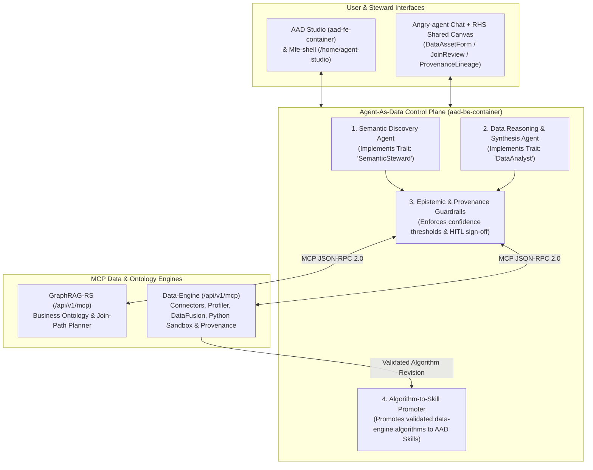
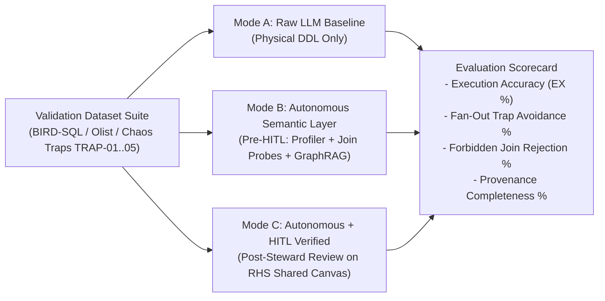

# Data Semantic Stewardship, Algorithm Synthesis & Provenance Orchestration PRD

## Overview
This PRD defines how **Agent-As-Data (AAD)** serves as the **Declarative Agent Control Plane, Guardrail Enforcer, and Skill Promotion Registry** for autonomous semantic layer discovery, multi-dataset query reasoning, dynamic algorithm synthesis, and human-in-the-loop (HITL) provenance across the 5-repository ecosystem (`Mfe-shell`, `Angry-agent`, `agent-as-data`, `Graphrag`, and `data-engine`).

---

## Cross-Repository Orchestration Architecture

---

## Core Capabilities & Requirements

### 1. Built-In Data & Semantic Trait Contracts (`/traits`)
To govern agents operating over enterprise datasets, AAD defines two standard 3-Element Trait Contracts:

1. **`SemanticSteward` Trait**:
   - **Capability Requirements**: Access to `data-engine` (`dataset_profile`, `join_probe`, `field_edit`, `join_verify`) and `Graphrag` (`ontology_sync_dataset`, `node_edit`, `edge_add`) MCP tools.
   - **Behavioral Invariants**:
     - *MUST ALWAYS* run an empirical sandbox probe (`join_probe`) before proposing a `JOINABLE_WITH` edge between two dataset fields.
     - *MUST NEVER* overwrite a human-certified (`epistemic_status == "verified"`) field description or join rule without routing through `pending_review`.
     - *MUST ALWAYS* preserve rejected join hypotheses as `FORBIDDEN_JOIN` negative constraints.
   - **Evaluation Criteria**: Precision of inferred field units/grains and zero recurrence of previously rejected join paths.

2. **`ProvenanceDataAnalyst` Trait**:
   - **Capability Requirements**: Access to `Graphrag` (`graphrag_find_join_path`, `graphrag_query`) and `data-engine` (`query_validate`, `query_execute`, `algorithm_add`, `algorithm_validate`, `algorithm_execute`, `provenance_read`).
   - **Behavioral Invariants**:
     - *MUST ALWAYS* call `graphrag_find_join_path` and `query_validate` (or `algorithm_validate`) before executing any query or Python algorithm.
     - *MUST NEVER* execute raw SQL or Python containing `FORBIDDEN_JOIN` paths or un-aggregated `1:N * 1:N` fan-out traps.
     - *MUST ALWAYS* attach the resulting `provenance_run_id`, `trust_summary` (`all_rules_human_verified`, `min_rule_confidence`), and Mermaid lineage graph to its response.

---

### 2. Epistemic Guardrails & Human-in-the-Loop (HITL) Escalation
AAD's outgoing and pre-tool guardrail interceptors (`agent-registry-execution-prd.md`) are extended with **Epistemic Provenance Guardrails**:
- **Unverified Rule Clarification Gate**:
  - When an agent's planned query or algorithm relies on a semantic rule or join hypothesis with `epistemic_status != "verified"` (or `confidence < guardrail_config.min_verified_confidence`, default `0.85`), the guardrail flags the response with `requires_steward_review: true` and attaches the candidate rule's `empirical_proof` payload so the UI (`Angry-agent` or AAD Workbench) can mount `./JoinHypothesisReviewWrapper` or `./DataAssetFormWrapper` on the RHS canvas for 1-click human verification.
- **PII & Sensitivity Aggregation Gate**:
  - Inspects `referenced_fields` returned by `data-engine`'s `query_validate`. If any field carries `sensitivity_tag == "pii"`, blocks direct projection unless wrapped in an approved anonymizing aggregation with a minimum cohort size (`COUNT(*) >= k`).

---

### 3. Promoting Validated `data-engine` Algorithms into Governed AAD Skills
When an agent dynamically synthesizes and validates a Python or SQL algorithm in `data-engine` (`/api/v1/algorithms/:id/validate`), AAD supports promoting that algorithm into a reusable, versioned **Skill** in AAD's `skills` registry (`POST /{{api_prefix}}/v1/skills/from-algorithm`):
1. Imports the algorithm's `name`, `description`, `input_bindings` schema, `expected_output_schema`, `algorithm_id`, `algorithm_version`, and `code_sha256`.
2. Binds the skill's implementation to invoke `data-engine`'s `algorithm_execute` MCP tool pinned to that immutable `algorithm_version` and `code_sha256`.
3. Synchronizes the skill's embeddings into `entity_embeddings` (`origin_type = 'skills'`) and adds `(Skill, implements, ProvenanceDataAnalyst)` and `(Skill, uses_tool, DataEngineMcp)` tuples into AAD's Knowledge Explorer.

---

### 4. Audit Telemetry & Provenance Cross-Linking (`agent_usage_logs`)
Whenever an AAD agent or skill executes a `data-engine` query or sandboxed algorithm:
- `agent_usage_logs.tool_calls` records the `provenance_run_id` and `provenance_signature_sha256` returned by `data-engine`.
- This provides an unbroken audit chain from **Caller Identity & Agent Revision (`agent_revisions`)** $\rightarrow$ **Tool Call (`agent_usage_logs`)** $\rightarrow$ **Semantic Rules & Dataset Snapshots (`data-engine` `provenance_runs`)**.

---

### 5. Native Federation Exposure (`aad-fe-container`)
To allow seamless navigation inside [`Mfe-shell`](https://github.com/PolecatWorks/Mfe-shell) (`ai.k8s`), `aad-fe-container` supports exposure as a Native Federation remote (`/mfe/agent-as-data` / `./routes`), enabling human stewards to switch between the **Agent & Skill Studio**, **Knowledge Explorer**, **Data-Engine Studio**, and **Angry-Agent Conversational Canvas** within a single unified portal.

---

### 6. Epistemic Ablation & Ground-Truth Benchmark Evaluation Matrix
To prove the measurable value of **Autonomous Semantic Discovery + Human-in-the-Loop (HITL) Stewardship** over raw LLM text-to-SQL, AAD's evaluation bench runs a **3-Mode Epistemic Ablation Matrix** against the validation datasets defined in `data-engine` (`BIRD-SQL`, `Valentine`, `Brazilian E-Commerce by Olist`, and the deterministic `de-be seed-validation-suite` Chaos Seeder):

| Evaluation Mode | Semantic Context Provided to Agent | Expected Behavior on `TRAP-01..05` & `BIRD-SQL` | Target Benchmark Outcome |
| :--- | :--- | :--- | :--- |
| **Mode A: Baseline Raw LLM** | Raw table DDL (`CREATE TABLE` / Arrow schema) only; no `data-engine` profiling or `Graphrag` ontology. | Falls into `TRAP-01` (homonym `account_id` join), misses `TRAP-02` (`cust_ref_key`), inflates revenue $2.45\times$ on `TRAP-03`, and over-reports Wave-3 revenue on `TRAP-04`. | Baseline reference (`0%` trap avoidance on Chaos Suite; standard raw LLM accuracy on BIRD-SQL). |
| **Mode B: Autonomous Semantic Layer (Pre-HITL)** | `SemanticSteward` agent profiles tables, runs `join_probe` value-overlap tests, detects 1:N/M:N cardinalities, and flags Wave-3 distribution shift (`epistemic_status = "drifted"`). | Automatically discovers `TRAP-02` (`0.97` Jaccard overlap), pre-aggregates `TRAP-03` M:N joins, and halts at the **Epistemic Guardrail Gate** (`requires_steward_review: true`) when encountering ambiguous `TRAP-01` or drifted `TRAP-04`. | `100%` prevention of silent wrong answers; surfaces low-confidence rules onto the RHS Shared Canvas for human review. |
| **Mode C: Autonomous + HITL Verified** | Human steward (or automated `BIRD-SQL` `evidence` oracle) reviews only the flagged low-confidence/drifted hypotheses on the RHS Shared Canvas (`verified` / `FORBIDDEN_JOIN`). | Blocks `TRAP-01` via `FORBIDDEN_JOIN`, applies the verified Wave-3 unit conversion (`amount_cents / 100.0`) on `TRAP-04`, executes the sandboxed Python model on `TRAP-05`, and emits a `100%` human-verified provenance chain. | **`100%` Execution Accuracy (`EX`)** on the Chaos Suite and significant (`+15%` to `+25%`) Execution Accuracy lift on `BIRD-SQL` with minimal steward clicks. |

---

## Related PRDs
- [Agent-As-Data Master PRD](./agent-as-data-prd.md)
- [Knowledge & Data System PRD](./knowledge-data-system-prd.md)
- [Agent Registry & Execution Engine PRD](./agent-registry-execution-prd.md)
- [Skills Registry & Tools PRD](./skills-registry-tools-prd.md)

