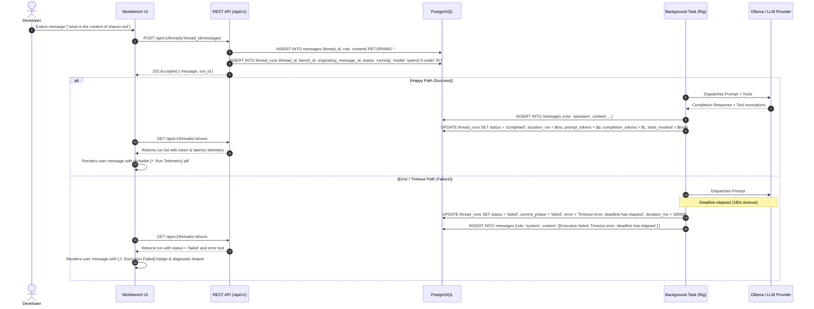

# 39. Workbench Run Telemetry & Error Visualization Specification

## Status: `draft`

## Primary PRD Reference
- [Workbench Benches, Threads & Workspace Memory PRD](../prds/workbench-bench-thread-prd.md)

---

## 1. Executive Summary & Objectives

During multi-turn execution within a Workbench Thread, developers currently lack visibility into the underlying LLM call metrics and failure modes. If an LLM invocation times out or errors, the background run fails silently from the user's perspective, dropping the active spinner without any explanation in the conversation pane. Furthermore, successful runs offer no insights into latency, token consumption, or the specific tools utilized.

This specification details:
1. **Schema & Backend Telemetry**:
   - Augmenting `thread_runs` with `originating_message_id`, token metrics (`prompt_tokens`, `completion_tokens`, `total_tokens`), `model`, `tools_invoked`, and `duration_ms`.
   - Recording an explicit timeline notification message (`role = 'system'`, `content = '[Execution failed: <error_message>]'`) when a run transitions to `failed`.
   - Enriching `/api/v1/threads/:id/runs` and the message response contract with this telemetry.
2. **Frontend Visual Logging & Interactive Expansion**:
   - Rendering an interactive, expandable card beneath user messages in `aad-fe-container`.
   - **In the Negative Case**: A prominent rose-tinted error badge (e.g. `⚠ Execution Failed: Timeout (180s)`) with an expandable drawer displaying the full error diagnostic string and a 1-click **Retry** button.
   - **In the Positive Case**: A subtle telemetry pill (e.g. `⚡ 1.4s · 497 tokens · 2 tools ▾`) expanding to show token breakdown, model used, latency, and tool chips.

---

## 2. Architecture & Data Flow



---

## 3. Database Schema Migration

A new reversible database migration `migrations/<timestamp>_add_thread_run_telemetry.up.sql` / `.down.sql`:

```sql
-- Up Migration
ALTER TABLE thread_runs
    ADD COLUMN originating_message_id UUID REFERENCES messages(id) ON DELETE SET NULL,
    ADD COLUMN model TEXT,
    ADD COLUMN prompt_tokens INT,
    ADD COLUMN completion_tokens INT,
    ADD COLUMN total_tokens INT,
    ADD COLUMN tools_invoked JSONB,
    ADD COLUMN duration_ms BIGINT;

CREATE INDEX idx_thread_runs_originating_message_id ON thread_runs(originating_message_id);
```

```sql
-- Down Migration
DROP INDEX IF EXISTS idx_thread_runs_originating_message_id;
ALTER TABLE thread_runs
    DROP COLUMN IF EXISTS originating_message_id,
    DROP COLUMN IF EXISTS model,
    DROP COLUMN IF EXISTS prompt_tokens,
    DROP COLUMN IF EXISTS completion_tokens,
    DROP COLUMN IF EXISTS total_tokens,
    DROP COLUMN IF EXISTS tools_invoked,
    DROP COLUMN IF EXISTS duration_ms;
```

---

## 4. Backend Implementation Specifications

### 4.1. Domain Models (`aad-be-container/src/models/run.rs`)
```rust
#[derive(Deserialize, Serialize, Debug, Clone, sqlx::FromRow)]
pub struct ThreadRun {
    pub id: Uuid,
    pub thread_id: Uuid,
    pub bench_id: Uuid,
    pub originating_message_id: Option<Uuid>,
    pub status: RunStatus,
    pub current_phase: RunPhase,
    pub active_tool_name: Option<String>,
    pub model: Option<String>,
    pub prompt_tokens: Option<i32>,
    pub completion_tokens: Option<i32>,
    pub total_tokens: Option<i32>,
    pub tools_invoked: Option<sqlx::types::Json<Vec<String>>>,
    pub duration_ms: Option<i64>,
    pub error: Option<String>,
    pub created_at: Option<chrono::DateTime<chrono::Utc>>,
    pub updated_at: Option<chrono::DateTime<chrono::Utc>>,
}
```

### 4.2. Run Lifecycle & Error Interception (`aad-be-container/src/webserver/threads.rs`)
1. **Creation**:
   On `create_message`:
   ```rust
   let run = sqlx::query_as::<_, ThreadRun>(
       "INSERT INTO thread_runs (thread_id, bench_id, originating_message_id, status, current_phase, model)
        VALUES ($1, $2, $3, 'running', 'thinking', $4) RETURNING *"
   )
   .bind(thread_id)
   .bind(bench_id)
   .bind(message.id)
   .bind(&state.config.llm.model)
   .fetch_one(&state.pool)
   .await?;
   ```
2. **Failure Handler**:
   When `process_thread_message` returns `Err(e)`:
   - Calculate elapsed duration `start_time.elapsed().as_millis() as i64`.
   - Update `thread_runs`:
     `UPDATE thread_runs SET status = 'failed', current_phase = 'failed', error = $1, duration_ms = $2, updated_at = NOW() WHERE id = $3`
   - Insert system error record:
     `INSERT INTO messages (thread_id, role, content) VALUES ($1, 'system', $2)`
     where `$2` is `format!("[Execution failed: {}]", e)`.
3. **Success Handler**:
   When `process_thread_message` succeeds:
   - Calculate elapsed duration.
   - Extract token counts if provided by the LLM response provider.
   - Update `thread_runs` with `status = 'completed'`, `duration_ms`, tokens, and recorded tools.

---

## 5. Frontend Implementation Specifications (`aad-fe-container`)

### 5.1. API Service & Data Layer (`api.service.ts`)
- Update `ThreadRun` TypeScript interface with:
  ```typescript
  export interface ThreadRun {
    id: string;
    thread_id: string;
    bench_id: string;
    originating_message_id?: string;
    status: 'pending' | 'running' | 'completed' | 'failed' | 'cancelled' | 'idle';
    current_phase: 'thinking' | 'executing_tool' | 'completed' | 'failed' | 'cancelled' | 'idle';
    active_tool_name?: string;
    model?: string;
    prompt_tokens?: number;
    completion_tokens?: number;
    total_tokens?: number;
    tools_invoked?: string[];
    duration_ms?: number;
    error?: string;
    created_at?: string;
    updated_at?: string;
  }
  ```
- Store loaded thread runs in `WorkbenchComponent.threadRuns: ThreadRun[] = []` keyed by `originating_message_id`.

### 5.2. Component Visual Layout (`workbench.component.html`)
Under each user message bubble:
```html
<!-- User Message Bubble -->
<div class="p-3 rounded-2xl max-w-[85%] text-sm shadow-sm whitespace-pre-wrap bg-indigo-600 text-white rounded-br-sm">
  {{ msg.content }}
</div>

<!-- Run Metadata Expansion Container -->
<div *ngIf="getRunForMessage(msg.id) as run" class="mt-1 flex flex-col items-end">
  
  <!-- Positive Case: Telemetry Pill -->
  <div *ngIf="run.status === 'completed'" class="flex items-center gap-1.5">
    <button (click)="toggleRunDetails(run.id)"
            class="inline-flex items-center gap-1 text-[11px] text-slate-500 hover:text-indigo-600 font-mono py-0.5 px-2 rounded-full hover:bg-slate-100 transition-colors">
      <mat-icon class="!w-3 !h-3 !text-[12px] text-amber-500">bolt</mat-icon>
      <span>{{ formatDuration(run.duration_ms) }}</span>
      <span *ngIf="run.total_tokens">· {{ run.total_tokens }} tok</span>
      <mat-icon class="!w-3 !h-3 !text-[12px]">{{ isRunExpanded(run.id) ? 'expand_less' : 'expand_more' }}</mat-icon>
    </button>
  </div>

  <!-- Negative Case: Failure Alert Badge -->
  <div *ngIf="run.status === 'failed'" class="flex items-center gap-1.5">
    <button (click)="toggleRunDetails(run.id)"
            class="inline-flex items-center gap-1 text-[11px] text-rose-600 font-medium py-0.5 px-2 rounded-full bg-rose-50 border border-rose-200 hover:bg-rose-100 transition-colors">
      <mat-icon class="!w-3 !h-3 !text-[12px]">error_outline</mat-icon>
      <span>Execution Failed</span>
      <mat-icon class="!w-3 !h-3 !text-[12px]">{{ isRunExpanded(run.id) ? 'expand_less' : 'expand_more' }}</mat-icon>
    </button>
  </div>

  <!-- Expanded Details Drawer -->
  <div *ngIf="isRunExpanded(run.id)" class="mt-1 p-2.5 rounded-lg border text-xs max-w-md w-full bg-slate-50"
       [ngClass]="run.status === 'failed' ? 'border-rose-200 text-rose-900 bg-rose-50/50' : 'border-slate-200 text-slate-700'">
    
    <!-- Failure Details -->
    <ng-container *ngIf="run.status === 'failed'">
      <div class="font-semibold text-rose-700 flex items-center justify-between">
        <span>Error Diagnostic:</span>
        <span class="font-mono text-[10px] text-slate-500">{{ formatDuration(run.duration_ms) }}</span>
      </div>
      <div class="mt-1 font-mono text-[11px] p-1.5 bg-white border border-rose-200 rounded text-rose-800 break-words">
        {{ run.error || 'Unknown execution error' }}
      </div>
      <div class="mt-2 flex items-center justify-between text-[11px]">
        <span class="text-slate-500 font-mono">Model: {{ run.model || 'unknown' }}</span>
        <button (click)="retryMessage(msg.content)" class="text-indigo-600 font-semibold hover:underline flex items-center gap-0.5">
          <mat-icon class="!w-3 !h-3 !text-[12px]">replay</mat-icon> Retry
        </button>
      </div>
    </ng-container>

    <!-- Success Telemetry Details -->
    <ng-container *ngIf="run.status === 'completed'">
      <div class="grid grid-cols-2 gap-2 text-[11px]">
        <div><span class="text-slate-400">Model:</span> <span class="font-mono font-medium">{{ run.model }}</span></div>
        <div><span class="text-slate-400">Duration:</span> <span class="font-mono font-medium">{{ run.duration_ms }} ms</span></div>
        <div *ngIf="run.prompt_tokens"><span class="text-slate-400">Prompt:</span> <span class="font-mono font-medium">{{ run.prompt_tokens }} tokens</span></div>
        <div *ngIf="run.completion_tokens"><span class="text-slate-400">Completion:</span> <span class="font-mono font-medium">{{ run.completion_tokens }} tokens</span></div>
      </div>
      <div *ngIf="run.tools_invoked?.length" class="mt-2 pt-2 border-t border-slate-200">
        <span class="text-slate-400 text-[10px] uppercase font-bold block mb-1">Tools Invoked:</span>
        <div class="flex flex-wrap gap-1">
          <span *ngFor="let t of run.tools_invoked" class="px-1.5 py-0.5 bg-indigo-50 border border-indigo-200 text-indigo-700 font-mono text-[10px] rounded">
            {{ t }}
          </span>
        </div>
      </div>
    </ng-container>
  </div>
</div>
```

---

## 6. Test Strategy

### 6.1. Unit Tests (`cargo test` & `ng test`)
1. **Backend Model Tests (`aad-be-container/src/models/run.rs`)**:
   - Verify serialization/deserialization of `ThreadRun` with telemetry fields (`prompt_tokens`, `model`, `tools_invoked`, `duration_ms`).
2. **Backend Failure Recording Test (`aad-be-container/src/webserver/threads.rs`)**:
   - Trigger a failing run and assert `thread_runs.status == 'failed'` and an explicit system message `[Execution failed: ...]` exists in `messages`.
3. **Frontend Component Tests (`workbench.component.spec.ts`)**:
   - Test `getRunForMessage` maps `originating_message_id` correctly.
   - Verify expanding/collapsing details drawer on click.
   - Verify failure badge shows error text and `[Retry]` populates the input.

### 6.2. Robot Framework Integration Test
- Add scenario in `integration-tests/tests/test_workbench.robot`:
  - Dispatch a prompt.
  - Verify `thread_runs` table has `originating_message_id` set to the message's ID.
  - Assert that on failure/timeout, the run status is `failed` and the UI exposes the error diagnostic container.
