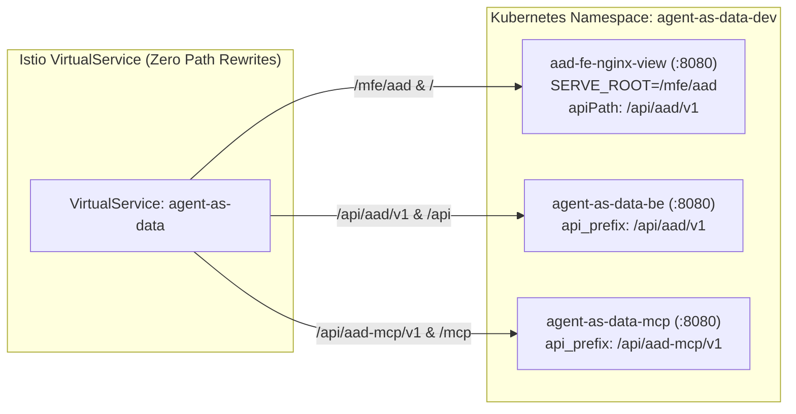

# Spec 40: Configurable Service Prefixes & Istio VirtualService Composition

- **Status**: `complete`
- **Phase**: Phase 23 (Configurable Service Prefixes & VirtualService Composition)
- **Primary PRD References**:
  - [Master PRD](../prds/agent-as-data-prd.md)
  - [MCP Server Container PRD](../prds/mcp-server-container-prd.md)
  - [Agent UI & Testing Kit PRD](../prds/agent-ui-testing-kit-prd.md)
- **Dependencies**:
  - [09-backend-modular-architecture-spec.md](./09-backend-modular-architecture-spec.md)
  - [23-mcp-server-container-spec.md](./23-mcp-server-container-spec.md)

---

## 1. Objective & Architectural Context

All Agent-As-Data microservices run in a shared Kubernetes namespace and expose their REST APIs, MCP endpoints, and Micro-Frontend (MFE) assets via an Istio `VirtualService` **without URI path rewrites**:
1. **MFE Frontend (`aad-fe-container` / `aad-fe-nginx-view`)**: Hosted under `/mfe/aad` (`SERVE_ROOT=/mfe/aad`) with runtime `app-config.json` configuring `"apiPath": "/api/aad/v1"`.
2. **Backend REST API (`aad-be-container`)**: Configured with `webservice.api_prefix: "/api/aad/v1"` so core v1 routes (`/agents`, `/skills`, `/traits`, `/agents/tools`, `/knowledge`, `/benches`, `/threads`, `/analytics`) are mounted directly under `{api_prefix}` while preserving `{api_prefix}/v1` (when `api_prefix` does not end with `/v1`) and `/api/v1` backward-compatible aliases.
3. **MCP Server (`aad-mcp-container`)**: Configured with `webservice.api_prefix: "/api/aad-mcp/v1"` so the MCP HTTP JSON-RPC 2.0 endpoint is mounted directly at `{api_prefix}/mcp` (`/api/aad-mcp/v1/mcp`) alongside `{api_prefix}/v1/mcp`, `/mcp`, and `/`.



---

## 2. Technical Specifications

### 2.1 Backend Router Nesting (`aad-be-container`)
- **File**: `aad-be-container/src/webserver/mod.rs`
- Extract a helper `v1_routes(state: AppState) -> Router` mounting:
  - `/health` (`GET` -> `"OK"`)
  - `/agents` -> `agents::router()`
  - `/agent-context/search` -> `search::router()`
  - `/skills` -> `skills::router()`
  - `/traits` -> `traits::router()`
  - `/agents/tools` -> `tools::router()`
  - `/knowledge` -> `knowledge::router()`
  - `/knowledge/mcp` -> `knowledge_mcp_handler::router()`
  - `/benches` -> `benches::router()`, `fs::router()`, `memory::router()`
  - `/threads` -> `threads::router()`, `fs::router()`
  - `/analytics` -> `analytics::router()`
  - Merged `execution::router()`
- In `app_router(state: AppState) -> Router`:
  - Normalize `prefix = state.config.webservice.api_prefix.trim_end_matches('/')` (fallback to `"/api/aad/v1"` if empty).
  - Mount `.route("/health", get(|| async { "OK" }))` at root `/health`.
  - Nest `v1_routes` directly under `prefix` (e.g., `/api/aad/v1/agents`) and, when `!prefix.ends_with("/v1")`, also nest `v1_routes` under `format!("{}/v1", prefix)` (so `api_prefix: "/api"` continues to serve `/api/v1/agents`).
  - Additionally, if neither `prefix` nor `format!("{}/v1", prefix)` equals `"/api/v1"`, nest `v1_routes` under `"/api/v1"` as a backward-compatible alias so existing CLI callers, KB tools, and integration suites continue to work without disruption.
- Update default configuration files to `api_prefix: "/api/aad/v1"`:
  - `aad-be-container/config/default.yaml`
  - `config/default.yaml`
  - `charts/agent-as-data/configs/config.yaml`

### 2.2 MCP Server Router Nesting (`aad-mcp-container`)
- **File**: `aad-mcp-container/src/webserver/mod.rs`
- Normalize `prefix = state.config.webservice.api_prefix.trim_end_matches('/')`.
- Mount `post(handle_http_rpc)` at:
  - `format!("{}/mcp", prefix)` (e.g. `/api/aad-mcp/v1/mcp`)
  - `format!("{}/v1/mcp", prefix)` (when `!prefix.ends_with("/v1")`, e.g. `/api/v1/mcp`)
  - `"/api/v1/mcp"` (when not already mounted by the above, preserving legacy route compatibility)
  - `"/mcp"`
  - `"/"`
- Update default configuration files to `api_prefix: "/api/aad-mcp/v1"`:
  - `aad-mcp-container/config/default.yaml`
  - `charts/agent-as-data-mcp/configs/config.yaml`

### 2.3 Frontend Runtime Configuration (`aad-fe-container`)
- **Runtime Config Asset**: `aad-fe-container/public/assets/contents/app-config.json`:
  ```json
  {
    "apiPath": "/api/aad/v1",
    "logLevel": "INFO"
  }
  ```
- **Dev Proxy**: `aad-fe-container/proxy.conf.json` proxies `/api` (covering `/api/aad/v1` and `/api/v1`) to `http://localhost:8080`.
- **`ApiService` (`aad-fe-container/src/app/services/api.service.ts`)**:
  - Default `baseUrl` set to `'/api/aad/v1'`.
  - Expose `getBaseUrl(): string`, `setBaseUrl(url: string): void`, and `loadAppConfig(configUrl?: string): Promise<void>` to allow runtime override from `assets/contents/app-config.json` (normalizing trailing slashes).
- **`SemanticSearchComponent` (`aad-fe-container/src/app/pages/semantic-search/semantic-search.component.ts`)**:
  - Use `ApiService` (or its configured `baseUrl`) so requests honour the configured prefix.

### 2.4 FluxCD Manifests (`fluxcd-dev/`)
- `fluxcd-dev/agent-as-data-be.yaml`: Set `config.webservice.api_prefix: "/api/aad/v1"`.
- `fluxcd-dev/agent-as-data-mcp.yaml`: Set `config.webservice.api_prefix: "/api/aad-mcp/v1"`.
- `fluxcd-dev/agent-as-data-fe.yaml`: Set `SERVE_ROOT` to `/mfe/aad` and `app-config.json` `apiPath` to `"/api/aad/v1"`.
- `fluxcd-dev/virtualservice.yaml`:
  - Route `/api/aad-mcp/v1` and `/mcp` to `agent-as-data-mcp`.
  - Route `/api/aad/v1` and `/api` to `agent-as-data-be`.
  - Route `/mfe/aad` and `/` to `aad-fe-nginx-view` without path rewrites.

---

## 3. Test Strategy (Strict TDD)

1. **Backend Unit Tests (`aad-be-container/src/webserver/mod.rs`)**:
   - Verify `/health` and `/api/aad/v1/health` return `200 OK` when `api_prefix` is `"/api/aad/v1"`.
   - Verify routes under `/api/aad/v1/agents`, custom `api_prefix` (`/api/custom-aad/v1/agents`), and backward-compatible `/api/v1/agents` are matched by `app_router` (do not return `404 Not Found`).
2. **MCP Server Integration Tests (`aad-mcp-container/tests/mcp_rpc_tests.rs`)**:
   - Verify JSON-RPC `ping` and `tools/call` (`hello`) succeed at `/api/aad-mcp/v1/mcp` when `api_prefix` is `"/api/aad-mcp/v1"`, as well as backward-compatible `/api/v1/mcp`, `/mcp`, and `/`.
3. **Frontend Unit Tests (`aad-fe-container/src/app/services/api.service.spec.ts`)**:
   - Verify default `getBaseUrl()` is `'/api/aad/v1'` and requests target `/api/aad/v1/...`.
   - Verify `setBaseUrl('/api/custom/v1/')` normalizes trailing slashes and directs subsequent HTTP requests to `/api/custom/v1/...`.
   - Verify `loadAppConfig()` applies `apiPath` from `assets/contents/app-config.json`.
   - Ensure all existing Angular component and service specs pass (`npm test -- --watch=false`).
