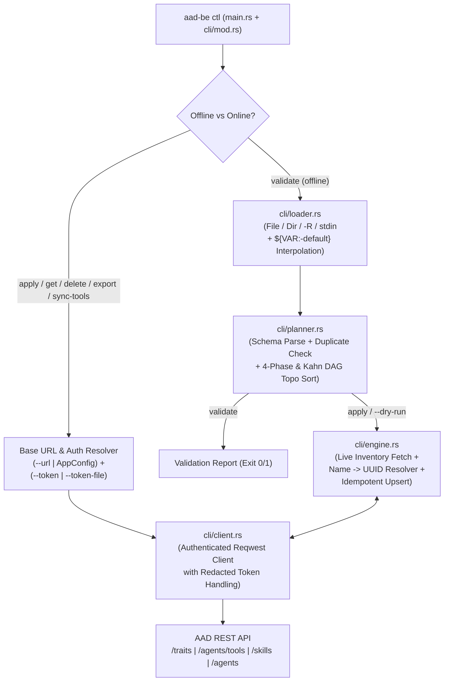

# Spec 41: CLI Manifest Hydration, Validation & Export Tool (`aad-be ctl`)

- **Status**: `complete`
- **Phase**: Phase 24 (CLI Hydration Tools & Ecosystem Manifest Pack)
- **Primary PRD References**:
  - [CLI Manifest & Hydration Tool PRD](../prds/cli-manifest-tool-prd.md)
  - [Agent Registry & Execution PRD](../prds/agent-registry-execution-prd.md)
  - [Keycloak Claims & Service Auth PRD](../prds/keycloak-claims-and-service-auth-prd.md)
- **Supersedes**:
  - [cli-manifest-tool-spec.md](./cli-manifest-tool-spec.md) (`deprecated`)
- **Dependencies**:
  - [09-backend-modular-architecture-spec.md](./09-backend-modular-architecture-spec.md)
  - [24-mcp-tool-ingestion-and-sync-spec.md](./24-mcp-tool-ingestion-and-sync-spec.md)
  - [34-automated-entity-embeddings-and-reverse-references-spec.md](./34-automated-entity-embeddings-and-reverse-references-spec.md)
  - [40-configurable-service-prefixes-and-virtualservice-spec.md](./40-configurable-service-prefixes-and-virtualservice-spec.md)

---

## 1. Objective & Architectural Overview

Replace the partial `aad-be ctl` prototype (which only supported `Agent` and `Skill` single-file `POST` calls with a broken `/v1` URL concatenation bug) with a complete, modular, strongly-typed CLI hydration and lifecycle tool supporting all four AAD registry types (**Traits**, **Tools**, **Skills**, **Agents**) strictly over the REST API.



---

## 2. Backend REST API Parity Enhancements (`aad-be-container`)

All changes below are strictly additive or bug-fixing with zero breaking changes to existing API consumers (`aad-fe-container` and existing Robot tests).

### 2.1 `GET {api_prefix}/agents` — List Active Agents (`src/webserver/agents.rs`)
- Mount `get(list_agents)` on `/` alongside existing `post(create_agent)` in `agents::router()`.
- Query parameter struct:
  ```rust
  #[derive(serde::Deserialize, Default)]
  pub struct ListAgentsParams {
      pub name: Option<String>,
  }
  ```
- SQL query:
  - When `name` is `None`: selects all columns required by `Agent` where `archived_at IS NULL ORDER BY created_at DESC`.
  - When `name` is `Some(name)`: filters `WHERE archived_at IS NULL AND name = $1 ORDER BY created_at DESC`.
- Returns `200 OK` with `Json<Vec<Agent>>`.
- Extract shared row-to-`Agent` mapping helper `row_to_agent(r: &sqlx::postgres::PgRow) -> Agent` reused by `get_agent` and `list_agents` to prevent column drift.

### 2.2 `GET {api_prefix}/agents/tools/{id}` — Read Single Tool (`src/webserver/tools.rs`)
- Mount `get(get_tool)` on `/{id}` alongside existing `delete(delete_tool)` in `tools::router()`.
- Queries `tools` by `id`; returns `200 OK` with `Json<Tool>` or `404 Not Found` if absent.

### 2.3 Full-Field Upsert & Embedding ID Fix on `POST {api_prefix}/traits` (`src/webserver/traits.rs`)
- Update `ON CONFLICT (name) DO UPDATE` in `create_trait`:
  ```sql
  ON CONFLICT (name) DO UPDATE
      SET description = EXCLUDED.description,
          version = EXCLUDED.version,
          capability_requirements = EXCLUDED.capability_requirements,
          behavioral_invariants = EXCLUDED.behavioral_invariants,
          evaluation_criteria = EXCLUDED.evaluation_criteria,
          tags = EXCLUDED.tags,
          guardrails = EXCLUDED.guardrails,
          owner_id = EXCLUDED.owner_id,
          updated_at = NOW()
  ```
- Pass `new_trait.id.unwrap_or(id)` (the persisted database row UUID returned by `RETURNING`) to `sync_entity_embeddings` and tracing logs so re-hydrating an existing Trait by name updates embeddings for the true existing entity ID rather than an orphaned transient UUID.

### 2.4 Degraded Bootstrap Registration on `POST {api_prefix}/agents/tools/register` (`src/models/tool.rs` & `src/webserver/tools.rs`)
- Extend `RegisterToolRequest`:
  ```rust
  #[serde(default)]
  pub allow_degraded_sync: bool,
  ```
- Behavior in `register_tool`:
  - When `transport_type == TransportType::Http` and `fetch_mcp_capabilities(url)` fails:
    - If `!payload.allow_degraded_sync`: return `422 Unprocessable Entity` (preserving existing fail-fast behavior).
    - If `payload.allow_degraded_sync`: persist/upsert with `sync_status = SyncStatus::Degraded`, `cached_capabilities = {"tools":[],"resources":[],"prompts":[]}`, and `last_sync_error = Some(err)`, returning `201 Created` with `RegisterToolResponse { sync_status: SyncStatus::Degraded, cached_tools_count: 0, ... }`.
  - When `fetch_mcp_capabilities(url)` succeeds (or non-HTTP transport), persist `sync_status = SyncStatus::Synced` and `last_sync_error = None` as before.

### 2.5 Ergonomic Serde Defaults on Domain Models (`src/models/`)
- Add `#[serde(default)]` on optional collection/JSON fields in `TraitContract` (`capability_requirements`, `behavioral_invariants`, `evaluation_criteria`, `tags`, `guardrails`) and `Skill` (`tags`) so partial JSON/YAML payloads deserialize cleanly without breaking existing strict callers.

---

## 3. CLI Architecture & Module Breakdown (`aad-be-container/src/cli/`)

Refactor `src/cli/` into clean, single-responsibility modules:

| File | Responsibility |
| :--- | :--- |
| `src/cli/mod.rs` | Module exports and `CtlArgs` / `CtlCommands` Clap derive structures. |
| `src/cli/error.rs` | Typed `CtlError` enum deriving `thiserror::Error` (zero `Result<_, String>`). |
| `src/cli/manifest.rs` | Strongly-typed YAML manifest DTOs (`ResourceManifest`, `TraitManifest`, `ToolManifest`, `SkillManifest`, `AgentManifest`), name/UUID reference types (`ResourceRef`), and portable export converters. |
| `src/cli/template.rs` | `--vars-file` YAML loader, `--var KEY=VALUE` parser, and `${VAR}` / `${VAR:-default}` interpolator. |
| `src/cli/loader.rs` | Multi-source YAML file/directory/stdin loader with deterministic lexicographical sorting and optional `-R`/`--recursive` traversal. |
| `src/cli/planner.rs` | Duplicate detection, 4-phase ordering (`Trait` -> `Tool` -> `Skill` -> `Agent`), Kahn's algorithm intra-phase DAG topological sort with cycle reporting, and offline `--self-contained` reference checker. |
| `src/cli/client.rs` | Authenticated `AadApiClient` (`reqwest::Client`), URL normalization helper (`normalize_base_url`), Bearer token handling (never logged), and typed REST methods for all 4 entity types + `sync-tools`. |
| `src/cli/ctl.rs` | High-level orchestration for `apply` (live + `--dry-run`), `validate`, `get`, `delete`, `export`, and `sync-tools`, plus YAML/JSON/table output formatting. |

---

## 4. Detailed Contracts

### 4.1 Clap CLI Definition (`src/main.rs` & `src/cli/mod.rs`)

```rust
#[derive(clap::Args, Debug)]
pub struct CtlArgs {
    /// Target AAD REST API base URL (e.g. http://localhost:8080/api/aad/v1).
    /// When set, bypasses loading server AppConfig and DB secrets.
    #[arg(long, env = "AAD_CTL_URL")]
    pub url: Option<String>,

    /// Bearer JWT token for Authorization header.
    #[arg(long, env = "AAD_CTL_TOKEN", conflicts_with = "token_file")]
    pub token: Option<String>,

    /// Path to file containing Bearer JWT token (trimmed).
    #[arg(long, conflicts_with = "token")]
    pub token_file: Option<PathBuf>,

    /// Fallback owner_id for manifests omitting owner_id.
    #[arg(
        long,
        env = "AAD_CTL_OWNER_ID",
        default_value = "00000000-0000-0000-0000-000000000000"
    )]
    pub default_owner_id: Uuid,

    /// HTTP client timeout in seconds.
    #[arg(long, default_value_t = 30)]
    pub timeout_secs: u64,

    /// Template variable override in KEY=VALUE form (repeatable).
    #[arg(long = "var", value_name = "KEY=VALUE")]
    pub vars: Vec<String>,

    /// Optional YAML file containing KEY: VALUE template variables.
    #[arg(long)]
    pub vars_file: Option<PathBuf>,

    #[command(subcommand)]
    pub command: CtlCommands,
}

#[derive(clap::Subcommand, Debug)]
pub enum CtlCommands {
    Apply {
        #[arg(short, long, required = true)]
        file: Vec<PathBuf>,
        #[arg(short = 'R', long)]
        recursive: bool,
        #[arg(long)]
        dry_run: bool,
        #[arg(long)]
        strict_traits: bool,
        #[arg(long)]
        allow_degraded_tools: bool,
    },
    Validate {
        #[arg(short, long, required = true)]
        file: Vec<PathBuf>,
        #[arg(short = 'R', long)]
        recursive: bool,
        #[arg(long)]
        self_contained: bool,
    },
    Get {
        resource_type: String,
        id_or_name: Option<String>,
        #[arg(short, long, value_enum, default_value_t = OutputFormat::Yaml)]
        output: OutputFormat,
    },
    Delete {
        resource_type: String,
        id_or_name: String,
        #[arg(long)]
        hard: bool,
    },
    Export {
        #[arg(long, value_delimiter = ',')]
        types: Option<Vec<String>>,
        #[arg(short, long, conflicts_with = "output_dir")]
        file: Option<PathBuf>,
        #[arg(long, conflicts_with = "file")]
        output_dir: Option<PathBuf>,
        #[arg(long)]
        raw_ids: bool,
    },
    SyncTools {
        id_or_name: Option<String>,
    },
}
```

### 4.2 URL Normalization & Standalone Resolution
- `validate` MUST execute immediately in `main.rs` without resolving `--url` or loading `AppConfig`.
- For online commands:
  - If `ctl_args.url` is `Some(raw)`: `normalize_base_url(&raw)` trims trailing `'/'` and verifies `http://` or `https://` scheme. `AppConfig` is NEVER loaded.
  - If `ctl_args.url` is `None`: loads `AppConfig::load(&cli.config_path, &cli.secrets_dir)` and builds:
    ```rust
    let host_port = config.webservice.address.replace("0.0.0.0", "127.0.0.1");
    let prefix = config.webservice.api_prefix.trim_matches('/');
    let base_url = if prefix.is_empty() {
        format!("http://{}", host_port)
    } else {
        format!("http://{}/{}", host_port, prefix)
    };
    ```
  - All API requests append direct resource paths (`/traits`, `/agents/tools`, `/agents/tools/register`, `/skills`, `/agents`) directly to `base_url` — NEVER appending an extra `/v1`!

### 4.3 Template Variable Interpolation (`src/cli/template.rs`)
- Syntax:
  - `${VAR_NAME}` — replaced with bound value; returns `CtlError::UnboundTemplateVariable { name, source }` if missing.
  - `${VAR_NAME:-default_value}` — replaced with bound value if present and non-empty, otherwise `default_value`.
- Precedence: `--var KEY=VALUE` overrides `--vars-file` YAML map, which overrides inline `:-default`.
- Variable names match `[A-Za-z_][A-Za-z0-9_]*`.

### 4.4 Typed Error Enum (`src/cli/error.rs`)
```rust
#[derive(Debug, thiserror::Error)]
pub enum CtlError {
    #[error("I/O error reading/writing '{path}': {source}")]
    Io { path: String, #[source] source: std::io::Error },
    #[error("Invalid base URL '{url}': {reason}")]
    InvalidUrl { url: String, reason: String },
    #[error("Configuration error: {0}")]
    Config(String),
    #[error("Invalid template variable '{raw}': expected KEY=VALUE")]
    InvalidVarFormat { raw: String },
    #[error("Unbound template variable '${{{name}}}' in '{source_name}'")]
    UnboundTemplateVariable { name: String, source_name: String },
    #[error("YAML parse error in '{source_name}' (doc #{doc_index}): {message}")]
    YamlParse { source_name: String, doc_index: usize, message: String },
    #[error("Schema validation error in '{source_name}' (doc #{doc_index}): {message}")]
    SchemaValidation { source_name: String, doc_index: usize, message: String },
    #[error("Duplicate {kind} resource named '{name}' (defined in '{first_source}' and '{second_source}')")]
    DuplicateResource { kind: String, name: String, first_source: String, second_source: String },
    #[error("Dependency cycle detected among {kind} resources: {cycle}")]
    DependencyCycle { kind: String, cycle: String },
    #[error("Unresolved {ref_kind} reference '{reference}' required by {owner_kind} '{owner_name}'")]
    UnresolvedReference { owner_kind: String, owner_name: String, ref_kind: String, reference: String },
    #[error("Unsupported resource type '{0}' (expected: trait, tool, skill, agent, or all)")]
    UnsupportedResourceType(String),
    #[error("Resource not found: {kind} '{identifier}'")]
    ResourceNotFound { kind: String, identifier: String },
    #[error("HTTP transport error calling {method} {url}: {source}")]
    HttpTransport { method: String, url: String, #[source] source: reqwest::Error },
    #[error("API error ({status}) on {method} {url}: {body}")]
    ApiError { method: String, url: String, status: u16, body: String },
    #[error("Serialization error: {0}")]
    Serialization(String),
}
```

### 4.5 Reference Resolution & Idempotent Upsert Rules
1. **Symbol Table Construction**:
   - Before executing Phase 1, `apply` fetches existing inventory via `GET /traits` (paginated + `GET /traits/{id}`), `GET /agents/tools`, `GET /skills`, and `GET /agents` to populate initial `name -> Uuid` maps (`existing_traits`, `existing_tools`, `existing_skills`, `existing_agents`).
2. **Resolution Function (`resolve_ref`)**:
   - If `reference` parses as `Uuid::parse_str(reference)`, return `Ok(uuid)` directly (backward compatibility with UUID manifests).
   - Otherwise look up `reference` in the corresponding live+batch symbol table; if missing, return `CtlError::UnresolvedReference`.
   - In `--dry-run` mode, if a resource is scheduled to be created in an earlier phase of the same batch and not yet in the live server, assign a deterministic placeholder UUID (`Uuid::nil()`) during dry-run planning so dry-run validates full name resolution end-to-end without mutating the server.
3. **4-Phase Execution**:
   - **Phase 1 (`Trait`)**: `POST /traits` (server upserts by `name` and returns persisted `TraitContract`). Action reported as `UPDATE` if `name` was in `existing_traits`, else `CREATE`.
   - **Phase 2 (`Tool`)**: `POST /agents/tools/register` with `allow_degraded_sync = cli_flag` (server upserts by `server_name` and returns `RegisterToolResponse { id, ... }`). Record `server_name -> id` in symbol table.
   - **Phase 3 (`Skill`, topological DAG order)**: Resolve `attached_tools` and `attached_skills`; check `implements_traits` / `uses_traits` (warn or fail if `--strict-traits`); `POST /skills` (server upserts by `name` and returns persisted `Skill` with `id`). Record `name -> id` in symbol table.
   - **Phase 4 (`Agent`, topological DAG order)**: Resolve `attached_tools`, `attached_skills`, and `attached_agents`; check `implements_traits` / `uses_traits`; match existing active agent by explicit `id` (if provided and exists) or `name`:
     - If found: `PUT /agents/{existing_id}` (reports `UPDATE`).
     - If not found: `POST /agents` (reports `CREATE`).
     - Record `name -> persisted_id` in symbol table.

### 4.6 Export Hygiene & Slugification
- Slugify filenames for `--output-dir`: lowercase, replace non-alphanumeric runs with `-`, trim leading/trailing `-` (e.g., `"Semantic Data Steward Agent"` -> `agents/semantic-data-steward-agent.yaml`).
- Disambiguate collisions with `-2`, `-3`, etc. if two distinct resources normalize to the same slug.
- Always omit empty/default boilerplate where appropriate or keep valid schema fields so `export` -> `validate --self-contained` passes with exit code `0`.

---

## 5. Comprehensive TDD Test Strategy

### 5.1 Unit Tests (`aad-be-container`: `cargo test`)
1. **URL Normalization**:
   - `http://localhost:8080/api/aad/v1/` -> `http://localhost:8080/api/aad/v1`
   - `AppConfig` with `0.0.0.0:8080` + `/api/aad/v1` -> `http://127.0.0.1:8080/api/aad/v1` (no `//`, no `/v1/v1`).
   - Invalid URL without scheme -> `CtlError::InvalidUrl`.
2. **Template Interpolation**:
   - `${VAR}` bound via `--vars-file`, overridden by `--var`.
   - `${VAR:-fallback}` uses fallback when unbound, uses override when bound.
   - Unbound `${VAR}` without default fails fast with `CtlError::UnboundTemplateVariable`.
3. **Manifest Loading & Multi-Doc Parsing**:
   - Multi-document YAML with empty trailing `---` document ignored cleanly.
   - Directory loading without `-R` vs with `-R` (deterministic lexicographical sort).
   - Strict schema rejection on unknown `type` or missing required fields (`CtlError::SchemaValidation`).
   - Backward compatibility parsing existing `sample-agents/*.yaml` files with hardcoded UUIDs.
4. **DAG Planner & Offline Validation**:
   - Guarantees output order: `Trait` -> `Tool` -> `Skill` (parent after child) -> `Agent` (orchestrator after sub-agents).
   - Rejects duplicate `(Trait, name)`, `(Tool, server_name)`, `(Skill, name)`, `(Agent, name)` with `CtlError::DuplicateResource`.
   - Detects direct (`A -> A`) and multi-hop (`A -> B -> C -> A`) cycles in both `Skill.attached_skills` and `Agent.attached_agents` with `CtlError::DependencyCycle`.
   - `--self-contained` rejects dangling `attached_tools`, `attached_skills`, `attached_agents`, `implements_traits`, and `uses_traits`.
5. **Portable Export Round-Trip**:
   - Converting live `TraitContract`, `Tool`, `Skill`, `Agent` structs (with UUID references) into `ResourceManifest` rewrites UUIDs to names (or preserves UUIDs with `--raw-ids`), strips timestamps, serializes to YAML, and parses back cleanly via the loader + validator.
6. **Auth Header & Redaction**:
   - `--token` and `--token-file` attach `Authorization: Bearer <jwt>` to outbound requests; error formatting never leaks token material.

### 5.2 HTTP / Mock-Server Integration Tests (`aad-be-container`: `cargo test`)
- Spin up an in-process Axum test server implementing the AAD REST API endpoints (or mock stateful router) and execute `run_ctl` directly against it:
  1. `apply --dry-run` verifies zero `POST`/`PUT` mutations occur and prints planned `CREATE`/`UPDATE` actions.
  2. `apply` hydrates a multi-entity set (Traits + Tools + nested Skills + nested Agents referencing each other by name) in strict dependency order, asserting `Authorization: Bearer <token>` header is sent.
  3. Second `apply` (idempotency check) verifies `Trait`/`Tool`/`Skill` upsert and `Agent` calls `PUT /agents/{id}` with zero duplicate records created.
  4. `get` by type, by UUID, and by name (`yaml`, `json`, `table`).
  5. `delete` by name and by UUID (including `--hard` query param on agents).
  6. `export` (to `--file` and `--output-dir`) followed by `validate --self-contained` on the exported artifacts.
  7. `sync-tools` targeting a specific tool by name and all tools.
  8. Backend router unit tests (`webserver/mod.rs` / `webserver/agents.rs` / `webserver/tools.rs`): verify `GET /api/aad/v1/agents` and `GET /api/aad/v1/agents/tools/{id}` routes do not 404, and `RegisterToolRequest` deserializes `allow_degraded_sync` defaulting to `false`.

### 5.3 Robot Framework Integration Tests (`integration-tests/`)
- Add `integration-tests/tests/test_journey_21_cli_hydration.robot` validating end-to-end against a live AAD backend + PostgreSQL:
  - Offline `aad-be ctl validate -f manifests/ecosystem -R --self-contained`
  - Live `aad-be ctl apply -f manifests/ecosystem -R --allow-degraded-tools --url ${BE_BASE_URL}/api/aad/v1`
  - Idempotent re-apply verifying entity counts do not increase
  - `aad-be ctl get`, `aad-be ctl export` -> `aad-be ctl validate`, and cleanup via `aad-be ctl delete`.

---

## 6. Acceptance Criteria
- All new and existing `cargo test` unit and HTTP integration tests pass (`make aad-be-test`).
- `aad-be ctl validate` works completely offline without `--url` or `config/default.yaml`.
- `aad-be ctl apply --url http://.../api/aad/v1` works without requiring backend DB config or secrets.
- Re-applying manifests across Traits, Tools, Skills, and Agents is 100% idempotent with zero duplicate records.
- `aad-be ctl export` produces clean, portable YAML that passes `aad-be ctl validate --self-contained`.
