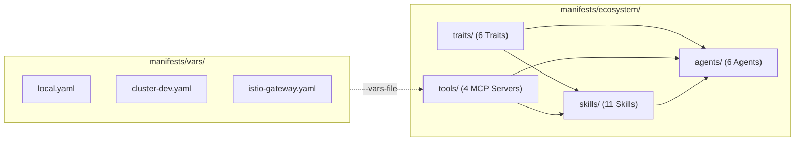

# Spec 42: Canonical PolecatWorks Ecosystem Hydration Manifest Pack

- **Status**: `complete`
- **Phase**: Phase 24 (CLI Hydration Tools & Ecosystem Manifest Pack)
- **Primary PRD References**:
  - [CLI Manifest & Hydration Tool PRD](../prds/cli-manifest-tool-prd.md)
  - [Data Semantic Stewardship, Algorithm Synthesis & Provenance PRD](../prds/data-semantic-stewardship-and-provenance-prd.md)
  - [Knowledge Base MCP Journey PRD](../prds/knowledge-mcp-journey-prd.md)
  - [Agent Registry & Execution PRD](../prds/agent-registry-execution-prd.md)
  - [MCP Server Container PRD](../prds/mcp-server-container-prd.md)
- **Dependencies**:
  - [41-cli-hydration-and-manifest-tool-spec.md](./41-cli-hydration-and-manifest-tool-spec.md)

---

## 1. Objective & Scope

Author a complete, self-contained, production-grade library of declarative YAML manifests under `manifests/` defining the **Traits**, **MCP Tools**, **Skills**, **Agents**, and **Environment Variable Presets** needed to enable every major workflow across the 5-repository PolecatWorks ecosystem (`Mfe-shell`, `Angry-agent`, `agent-as-data`, `Graphrag`, and `data-engine`), and expose convenient `Makefile` targets for validation and hydration.



---

## 2. Directory Structure & File Inventory

```text
manifests/
├── vars/
│   ├── local.yaml
│   ├── cluster-dev.yaml
│   └── istio-gateway.yaml
└── ecosystem/
    ├── traits/
    │   ├── semantic-steward.yaml
    │   ├── provenance-data-analyst.yaml
    │   ├── knowledge-curator.yaml
    │   ├── interactive-canvas-coeditor.yaml
    │   ├── expense-compliance-auditor.yaml
    │   └── registry-governance-architect.yaml
    ├── tools/
    │   ├── data-engine-mcp.yaml
    │   ├── graphrag-mcp.yaml
    │   ├── aad-knowledge-mcp.yaml
    │   └── aad-mcp-server.yaml
    ├── skills/
    │   ├── onboard-and-profile-dataset.yaml
    │   ├── probe-and-verify-join-hypothesis.yaml
    │   ├── plan-semantic-join-path.yaml
    │   ├── validate-and-execute-federated-sql.yaml
    │   ├── synthesize-and-run-sandbox-algorithm.yaml
    │   ├── audit-provenance-lineage.yaml
    │   ├── curate-knowledge-graph.yaml
    │   ├── coedit-shared-canvas-mfe.yaml
    │   ├── extract-and-validate-expense-receipt.yaml
    │   ├── audit-and-route-expense-approval.yaml
    │   └── evaluate-epistemic-ablation-suite.yaml
    └── agents/
        ├── semantic-data-steward-agent.yaml
        ├── provenance-data-analyst-agent.yaml
        ├── knowledge-ontology-curator-agent.yaml
        ├── back-office-expense-auditor-agent.yaml
        ├── epistemic-benchmark-governance-agent.yaml
        └── polecatworks-ecosystem-orchestrator-agent.yaml
```

---

## 3. Detailed Entity Contracts

### 3.1 Environment Variable Presets (`manifests/vars/`)

| Variable | `local.yaml` | `cluster-dev.yaml` | `istio-gateway.yaml` |
| :--- | :--- | :--- | :--- |
| `DATA_ENGINE_MCP_URL` | `http://localhost:8083/api/data-engine/v1/mcp` | `http://data-engine-be.data-engine-dev.svc.cluster.local/api/data-engine/v1/mcp` | `http://ai.k8s/api/data-engine/v1/mcp` |
| `GRAPHRAG_MCP_URL` | `http://localhost:8081/api/graphrag/v1/mcp` | `http://graphrag.graphrag-dev.svc.cluster.local/api/graphrag/v1/mcp` | `http://ai.k8s/api/graphrag/v1/mcp` |
| `AAD_KNOWLEDGE_MCP_URL` | `http://localhost:8080/api/aad/v1/knowledge/mcp` | `http://agent-as-data-be.agent-as-data-dev.svc.cluster.local/api/aad/v1/knowledge/mcp` | `http://aad.k8s/api/aad/v1/knowledge/mcp` |
| `AAD_MCP_URL` | `http://localhost:8082/api/aad-mcp/v1/mcp` | `http://agent-as-data-mcp.agent-as-data-dev.svc.cluster.local/api/aad-mcp/v1/mcp` | `http://aad.k8s/api/aad-mcp/v1/mcp` |

### 3.2 Traits (`manifests/ecosystem/traits/`)

| Name | Target Apps | Key Capability Requirements & Behavioral Invariants |
| :--- | :--- | :--- |
| `SemanticSteward` | `data-engine`, `Graphrag` | Requires `dataset_profile`, `join_probe`, `field_edit`, `join_verify`, `ontology_sync_dataset`. Must run empirical probe before proposing `JOINABLE_WITH`; never overwrite `verified` rules without `pending_review`; preserve rejected joins as `FORBIDDEN_JOIN`. |
| `ProvenanceDataAnalyst` | `data-engine`, `Graphrag` | Requires `graphrag_find_join_path`, `query_validate`, `query_execute`, `algorithm_*`, `provenance_read`. Must validate before execution; block `FORBIDDEN_JOIN` and un-aggregated `1:N * 1:N` fan-out traps; enforce PII cohort aggregation; always attach `provenance_run_id`, `trust_summary`, and Mermaid lineage. |
| `KnowledgeCurator` | `agent-as-data`, `Graphrag` | Requires `search_knowledge`, `read_knowledge`, `ingest_knowledge`, `update_knowledge`, `traverse_knowledge_graph`, `graphrag_ingest`, `graphrag_query`, `node_*`, `edge_*`. Search before adding to prevent duplicates; cite node IDs; never delete verified knowledge nodes without confirmation. |
| `InteractiveCanvasCoEditor` | `Angry-agent`, `Mfe-shell` | Requires `inspect_active_mfe`, `patch_active_mfe`, `switch_active_mfe`. Inspect live canvas state/schema before patching; emit minimal RFC 6902 JSON patches with AI field attributions; honor `activeSelection`; route low-confidence hypotheses to HITL Steward cards. |
| `ExpenseComplianceAuditor` | `agent-as-data`, `aad-mcp-container` | Requires `run_ocr`, `convert_currency`, `lookup_hr_org_chart`, `lookup_cost_center`, `send_slack_message`. Validate line-item sums and currency conversions; enforce corporate spending caps; route approvals via verified HR org chart. |
| `RegistryGovernanceArchitect` | `agent-as-data`, `data-engine`, `Graphrag` | Governs agent/skill contract verification, skill promotion from validated algorithms, overlap detection, and 3-mode epistemic ablation benchmarking (`TRAP-01..05`, `BIRD-SQL`). |

### 3.3 Tools (`manifests/ecosystem/tools/`)

| `server_name` | `transport_type` | Parameterized `endpoint_config.url` | `sync_policy` |
| :--- | :--- | :--- | :--- |
| `data-engine-mcp` | `http` | `${DATA_ENGINE_MCP_URL:-http://localhost:8083/api/data-engine/v1/mcp}` | `manual` |
| `graphrag-mcp` | `http` | `${GRAPHRAG_MCP_URL:-http://localhost:8081/api/graphrag/v1/mcp}` | `manual` |
| `aad-knowledge-mcp` | `http` | `${AAD_KNOWLEDGE_MCP_URL:-http://localhost:8080/api/aad/v1/knowledge/mcp}` | `manual` |
| `aad-mcp-server` | `http` | `${AAD_MCP_URL:-http://localhost:8082/api/aad-mcp/v1/mcp}` | `manual` |

### 3.4 Skills (`manifests/ecosystem/skills/`)

| Skill `name` | `implements_traits` | `attached_tools` | `attached_skills` |
| :--- | :--- | :--- | :--- |
| `onboard_and_profile_dataset` | `["SemanticSteward"]` | `["data-engine-mcp", "graphrag-mcp"]` | `[]` |
| `probe_and_verify_join_hypothesis` | `["SemanticSteward"]` | `["data-engine-mcp", "graphrag-mcp"]` | `[]` |
| `plan_semantic_join_path` | `["ProvenanceDataAnalyst"]` | `["graphrag-mcp"]` | `[]` |
| `validate_and_execute_federated_sql` | `["ProvenanceDataAnalyst"]` | `["data-engine-mcp"]` | `["plan_semantic_join_path"]` |
| `synthesize_and_run_sandbox_algorithm` | `["ProvenanceDataAnalyst"]` | `["data-engine-mcp"]` | `["plan_semantic_join_path"]` |
| `audit_provenance_lineage` | `["ProvenanceDataAnalyst"]` | `["data-engine-mcp"]` | `[]` |
| `curate_knowledge_graph` | `["KnowledgeCurator"]` | `["aad-knowledge-mcp", "graphrag-mcp"]` | `[]` |
| `coedit_shared_canvas_mfe` | `["InteractiveCanvasCoEditor"]` | `[]` | `[]` |
| `extract_and_validate_expense_receipt` | `["ExpenseComplianceAuditor"]` | `["aad-mcp-server"]` | `[]` |
| `audit_and_route_expense_approval` | `["ExpenseComplianceAuditor"]` | `["aad-mcp-server"]` | `["extract_and_validate_expense_receipt"]` |
| `evaluate_epistemic_ablation_suite` | `["RegistryGovernanceArchitect"]` | `["data-engine-mcp", "graphrag-mcp"]` | `["onboard_and_profile_dataset", "validate_and_execute_federated_sql"]` |

Every skill MUST define realistic `description`, detailed markdown `definition`, `tags`, and Draft-07 JSON Schema `input_schema` and `output_schema`.

### 3.5 Agents (`manifests/ecosystem/agents/`)

| Agent `name` | `implements_traits` | `uses_traits` | `attached_tools` | `attached_skills` | `attached_agents` |
| :--- | :--- | :--- | :--- | :--- | :--- |
| `Semantic Data Steward Agent` | `["SemanticSteward", "InteractiveCanvasCoEditor"]` | `[]` | `["data-engine-mcp", "graphrag-mcp"]` | `["onboard_and_profile_dataset", "probe_and_verify_join_hypothesis", "coedit_shared_canvas_mfe"]` | `[]` |
| `Provenance Data Analyst Agent` | `["ProvenanceDataAnalyst", "InteractiveCanvasCoEditor"]` | `["SemanticSteward"]` | `["data-engine-mcp", "graphrag-mcp"]` | `["plan_semantic_join_path", "validate_and_execute_federated_sql", "synthesize_and_run_sandbox_algorithm", "audit_provenance_lineage", "coedit_shared_canvas_mfe"]` | `[]` |
| `Knowledge & Ontology Curator Agent` | `["KnowledgeCurator"]` | `[]` | `["aad-knowledge-mcp", "graphrag-mcp"]` | `["curate_knowledge_graph"]` | `[]` |
| `Back-Office Expense Auditor Agent` | `["ExpenseComplianceAuditor"]` | `[]` | `["aad-mcp-server"]` | `["extract_and_validate_expense_receipt", "audit_and_route_expense_approval"]` | `[]` |
| `Epistemic Benchmark & Governance Agent` | `["RegistryGovernanceArchitect"]` | `["SemanticSteward", "ProvenanceDataAnalyst"]` | `["data-engine-mcp", "graphrag-mcp", "aad-knowledge-mcp"]` | `["evaluate_epistemic_ablation_suite", "audit_provenance_lineage"]` | `["Semantic Data Steward Agent", "Provenance Data Analyst Agent"]` |
| `PolecatWorks Ecosystem Orchestrator Agent` | `["InteractiveCanvasCoEditor", "RegistryGovernanceArchitect"]` | `["SemanticSteward", "ProvenanceDataAnalyst", "KnowledgeCurator", "ExpenseComplianceAuditor"]` | `[]` | `["coedit_shared_canvas_mfe"]` | `["Semantic Data Steward Agent", "Provenance Data Analyst Agent", "Knowledge & Ontology Curator Agent", "Back-Office Expense Auditor Agent"]` |

Each agent MUST define a comprehensive `agent_definition` (`prompt` + workflow instructions), `guardrail_config` (including `min_verified_confidence: 0.85` for data/steward agents), `input_guardrails` / `output_guardrails`, `judge_threshold`, `model`, and `tags`.

---

## 4. `Makefile` Convenience Targets

Add/update targets in `Makefile`:
- `validate-manifests`: Runs `aad-be ctl validate -f ../manifests/ecosystem -R --self-contained` against default, `local.yaml`, `cluster-dev.yaml`, and `istio-gateway.yaml` presets.
- `hydrate-ecosystem`: Runs `aad-be ctl apply -f ../manifests/ecosystem -R --allow-degraded-tools --url $(AAD_CTL_URL)` (accepting optional `VARS_FILE`, `AAD_CTL_TOKEN`, and `DRY_RUN=1`).
- `apply-sample-agents`: Updated to invoke `aad-be ctl apply -f ../sample-agents --url $(AAD_CTL_URL)` directly in one dependency-ordered invocation.

---

## 5. Test & Verification Strategy

1. **Automated Rust Manifest Validation Test (`aad-be-container`)**:
   - Add an integration test in `aad-be-container/tests/` (or `src/cli/ctl.rs` tests) that loads the actual repository `../manifests/ecosystem` directory with each of the three preset files (`local.yaml`, `cluster-dev.yaml`, `istio-gateway.yaml`) and asserts:
     - All 27 resources (6 Traits, 4 Tools, 11 Skills, 6 Agents) parse cleanly with zero errors.
     - `--self-contained` offline validation passes with zero dangling references, zero duplicates, and zero DAG cycles.
     - Topological order places all Traits before Tools, Tools before Skills, `plan_semantic_join_path` before `validate_and_execute_federated_sql` / `synthesize_and_run_sandbox_algorithm`, `extract_and_validate_expense_receipt` before `audit_and_route_expense_approval`, and specialist agents before `Epistemic Benchmark & Governance Agent` and `PolecatWorks Ecosystem Orchestrator Agent`.
     - Hydrating the full 27-resource pack against the in-process mock AAD server succeeds on first pass (`27 created`) and on second pass (`27 updated, 0 created`), and `export` -> `validate --self-contained` passes cleanly.
   - Verify legacy `../sample-agents/` YAML files continue to parse and validate cleanly.
2. **Robot Framework E2E Test (`integration-tests/tests/test_journey_21_cli_hydration.robot`)**:
   - Exercises live hydration of `manifests/ecosystem` against PostgreSQL-backed `aad-be-container` (when backend is online), verifies all 4 entity lists via REST API, confirms idempotency on second run, and tests `export` round-trip.

---

## 6. Acceptance Criteria
- All 27 ecosystem manifests + 3 environment variable presets exist under `manifests/` with complete, accurate schemas, invariants, and prompts aligned with the 5-repo PRDs.
- `aad-be ctl validate -f manifests/ecosystem -R --self-contained` passes for all 3 env presets.
- Automated Rust tests verify full validation, dependency ordering, mock hydration, idempotent re-apply, and export round-trip for the entire ecosystem pack.
