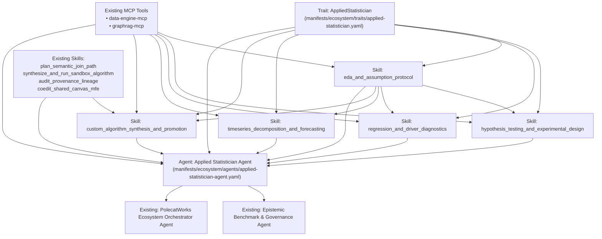

# Spec 43: Statistical Analytics Ecosystem Manifests Extension (`manifests/ecosystem/`)

- **Status**: `complete`
- **Phase**: Phase 25 (Statistical Analytics Skills, Agent & Rigor Guardrails)
- **Primary PRD References**:
  - [Analytics Thinking Skills, AppliedStatistician Trait & Statistical Guardrails PRD](../prds/analytics-thinking-skills-and-guardrails-prd.md)
  - [CLI Manifest & Hydration Tool PRD](../prds/cli-manifest-tool-prd.md)
- **Dependencies**:
  - [41-cli-hydration-and-manifest-tool-spec.md](./41-cli-hydration-and-manifest-tool-spec.md)
  - [42-ecosystem-hydration-manifests-pack-spec.md](./42-ecosystem-hydration-manifests-pack-spec.md)

---

## 1. Objective
Extend the canonical PolecatWorks Ecosystem Hydration Manifest Pack (`manifests/ecosystem/`, introduced in Spec 42) with **7 new statistical analytics manifests** (bringing the pack from 27 → 34 resources: 7 Traits, 4 Tools, 16 Skills, 7 Agents) and wire the new `Applied Statistician Agent` into the ecosystem orchestrator and benchmark governance agents so operators can validate and hydrate complete statistician-grade analytics capabilities via `make validate-manifests` and `make hydrate-ecosystem`.

---

## 2. Manifest Dependency Graph Extension

---

## 3. Manifest Definitions

### 3.1 New Trait (`manifests/ecosystem/traits/applied-statistician.yaml`)
- `type: Trait`, `name: AppliedStatistician`, `version: "1.0.0"`, `tags: ["analytics", "statistics", "provenance"]`
- `capability_requirements`: `graphrag_find_join_path`, `graphrag_query`, `stat_describe_and_check`, `stat_hypothesis_test`, `stat_power_analysis`, `stat_correlation_vif`, `stat_regression_fit`, `stat_timeseries_analyze`, `query_validate`, `query_execute`, `algorithm_add`, `algorithm_validate`, `algorithm_execute`, `provenance_read`.
- `behavioral_invariants`:
  - Always run `stat_describe_and_check` (or verify `statistical_profile` from `graphrag-mcp`) before selecting a parametric test or regression family.
  - Always inspect `assumption_checks` and reason from `recommended_alternative` whenever parametric assumptions fail.
  - Always report sample size ($n$), standardized effect size, confidence interval, and `provenance_run_id` alongside any $p$-value.
  - Always check for stratification reversals (Simpson's paradox) and apply multiple-comparison corrections (BH-FDR / Holm / Bonferroni) when testing $> 1$ segment/hypothesis.
  - Never claim causation from observational correlation/regression without explicit causal identification.
- `evaluation_criteria`: `100%` trap avoidance on `STAT-TRAP-01..04`; `100%` provenance & effect-size disclosure completeness.
- `guardrails`: `{ "statistical_rigor": { "enabled": true, "mode": "soft", "require_assumption_acknowledgement": true, "require_multiple_testing_correction_above": 1, "require_effect_size_and_ci": true, "flag_unverified_causal_language": true } }`.

### 3.2 New Composable Skills (`manifests/ecosystem/skills/`)

| Filename | `name` | `implements_traits` | `attached_tools` | `attached_skills` |
| :--- | :--- | :--- | :--- | :--- |
| `eda-and-assumption-protocol.yaml` | `eda_and_assumption_protocol` | `["AppliedStatistician"]` | `["data-engine-mcp", "graphrag-mcp"]` | `[]` |
| `hypothesis-testing-and-experimental-design.yaml` | `hypothesis_testing_and_experimental_design` | `["AppliedStatistician"]` | `["data-engine-mcp"]` | `["eda_and_assumption_protocol"]` |
| `regression-and-driver-diagnostics.yaml` | `regression_and_driver_diagnostics` | `["AppliedStatistician"]` | `["data-engine-mcp"]` | `["eda_and_assumption_protocol"]` |
| `timeseries-decomposition-and-forecasting.yaml` | `timeseries_decomposition_and_forecasting` | `["AppliedStatistician"]` | `["data-engine-mcp"]` | `["eda_and_assumption_protocol"]` |
| `custom-algorithm-synthesis-and-promotion.yaml` | `custom_algorithm_synthesis_and_promotion` | `["AppliedStatistician"]` | `["data-engine-mcp"]` | `["eda_and_assumption_protocol", "synthesize_and_run_sandbox_algorithm"]` |

Every skill manifest defines full markdown `definition`, `tags`, and Draft-07 JSON Schema `input_schema` and `output_schema` matching `data-engine`'s `StatisticalResultEnvelope` contract.

### 3.3 New Specialist Agent & Orchestrator Wiring (`manifests/ecosystem/agents/`)
- **New `applied-statistician-agent.yaml`**:
  - `name: "Applied Statistician Agent"`
  - `implements_traits: ["AppliedStatistician", "ProvenanceDataAnalyst", "InteractiveCanvasCoEditor"]`
  - `uses_traits: ["SemanticSteward"]`
  - `attached_tools: ["data-engine-mcp", "graphrag-mcp"]`
  - `attached_skills`: all 5 statistical skills + `plan_semantic_join_path`, `audit_provenance_lineage`, `coedit_shared_canvas_mfe`
  - `guardrail_config`: `{ "min_verified_confidence": 0.85, "statistical_rigor": { "enabled": true, "mode": "soft", "require_assumption_acknowledgement": true, "require_multiple_testing_correction_above": 1, "require_effect_size_and_ci": true, "flag_unverified_causal_language": true } }`
  - `agent_definition`: Full methodological workflow instructing the agent to consult `graphrag-mcp` caveats, execute `data-engine-mcp` `stat_*` tools, mount `./StatisticalDiagnosticsWrapper` on the RHS Shared Canvas, and attach `provenance_run_id`.
- **Update existing ecosystem agents**:
  - `epistemic-benchmark-governance-agent.yaml`: Add `"AppliedStatistician"` to `uses_traits` and `"Applied Statistician Agent"` to `attached_agents` (for evaluating `STAT-TRAP-01..04`).
  - `polecatworks-ecosystem-orchestrator-agent.yaml`: Add `"AppliedStatistician"` to `uses_traits` and `"Applied Statistician Agent"` to `attached_agents`.

---

## 4. Test Strategy (TDD)

### Unit & Mock Hydration Tests (`cargo test`)
1. `test_ecosystem_pack_includes_34_resources_with_statistical_extension`: Loads `../manifests/ecosystem` against all 3 env presets (`local.yaml`, `cluster-dev.yaml`, `istio-gateway.yaml`), asserting 34 resources (7 Traits, 4 Tools, 16 Skills, 7 Agents), zero dangling references under `--self-contained`, and zero DAG cycles.
2. `test_statistical_skill_and_agent_topological_order`: Verifies `eda_and_assumption_protocol` and `synthesize_and_run_sandbox_algorithm` precede their dependent statistical skills, and `Applied Statistician Agent` precedes `Epistemic Benchmark & Governance Agent` and `PolecatWorks Ecosystem Orchestrator Agent`.
3. `test_statistical_pack_idempotent_apply_and_export_roundtrip`: Runs `aad-be ctl apply` twice against the in-process mock AAD server (34 created → 34 updated, 0 duplicates), then `export` → `validate --self-contained`.

### Integration Tests (Robot Framework)
- Extend `integration-tests/tests/test_journey_21_cli_hydration.robot` to assert `AppliedStatistician` trait, all 5 statistical skills (with resolved `attached_skills` and `attached_tools` UUIDs), and `Applied Statistician Agent` (with `guardrail_config.statistical_rigor`) are present after `aad-be ctl apply -f manifests/ecosystem -R --allow-degraded-tools`, and verify `aad-be ctl sync-tools data-engine-mcp` ingests `stat_*` tools when `data-engine` is reachable.
