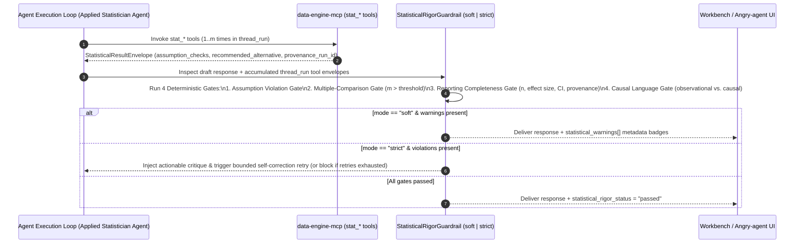

# Spec 44: Statistical Rigor Guardrails (`soft`/`strict`) & `STAT-TRAP-01..04` Ablation Evaluation

- **Status**: `complete`
- **Phase**: Phase 25 (Statistical Analytics Skills, Agent & Rigor Guardrails)
- **Primary PRD References**:
  - [Analytics Thinking Skills, AppliedStatistician Trait & Statistical Guardrails PRD](../prds/analytics-thinking-skills-and-guardrails-prd.md)
  - [Data Semantic Stewardship, Algorithm Synthesis & Provenance PRD](../prds/data-semantic-stewardship-and-provenance-prd.md)
  - [Agent Registry & Execution PRD](../prds/agent-registry-execution-prd.md)
- **Dependencies**:
  - [05-execution-guardrails-engine-spec.md](./05-execution-guardrails-engine-spec.md)
  - [06-agent-test-judge-engine-spec.md](./06-agent-test-judge-engine-spec.md)
  - [43-statistical-analytics-manifests-pack-spec.md](./43-statistical-analytics-manifests-pack-spec.md)

---

## 1. Objective
Extend `aad-be-container`'s agent execution guardrail interceptor with deterministic **Statistical Rigor Guardrails** (`guardrail_config.statistical_rigor`) supporting `soft` (warning badges, default) and `strict` (retry/blocking enforcement) modes across four methodological gates, and wire end-to-end evaluation of the hydrated `Applied Statistician Agent` against `data-engine`'s `STAT-TRAP-01`..`STAT-TRAP-04` benchmark scenarios.

---

## 2. Guardrail Interception Flow



---

## 3. Technical Specification

### 3.1 Configuration Model (`StatisticalRigorGuardrailConfig` in `src/models/execution.rs`)
Stored inside `Agent.guardrail_config["statistical_rigor"]`:
```rust
#[derive(Debug, Clone, Serialize, Deserialize, PartialEq)]
#[serde(rename_all = "snake_case")]
pub enum GuardrailEnforcementMode {
    Soft,
    Strict,
}

#[derive(Debug, Clone, Serialize, Deserialize, PartialEq)]
pub struct StatisticalRigorGuardrailConfig {
    pub enabled: bool,
    pub mode: GuardrailEnforcementMode,
    pub require_assumption_acknowledgement: bool,
    pub require_multiple_testing_correction_above: usize,
    pub require_effect_size_and_ci: bool,
    pub flag_unverified_causal_language: bool,
}
```
No hardcoded runtime fallback defaults in logic; defaults are explicitly supplied via the `AppliedStatistician` `Trait` / `Applied Statistician Agent` manifests (Spec 43) and validated on agent save.

### 3.2 Four Deterministic Statistical Gates (`src/guardrails/statistical.rs`)
Given `response_text: &str` and `tool_envelopes: &[StatisticalEnvelopeSummary]` collected from the current `thread_run`:
1. **Assumption Violation Gate (`ASSUMPTION_UNACKNOWLEDGED`)**:
   - Triggers when any tool envelope in the run contains an `assumption_checks` entry with `status == "failed"` AND a `recommended_alternative`, yet `response_text` does not reference the alternative method name (e.g., `mann_whitney`, `kruskal`, `hc3`, `huber`, `differenc`) or explicitly explain the assumption violation.
2. **Multiple-Comparison Gate (`UNADJUSTED_MULTIPLE_TESTING`)**:
   - Counts total hypothesis tests executed in the run (`stat_hypothesis_test` calls or multi-segment test count).
   - Triggers when `test_count > config.require_multiple_testing_correction_above` and none of the envelopes report an `adjustment_method` (`fdr_bh`, `holm`, `bonferroni`).
3. **Reporting Completeness Gate (`INCOMPLETE_STATISTICAL_REPORT`)**:
   - Triggers when `response_text` asserts a $p$-value or statistical significance (`p <`, `p =`, `statistically significant`) without:
     - A backing `stat_*` or `algorithm_execute` tool call (`UNGROUNDED_STATISTICAL_CLAIM`), OR
     - Mentioning sample size ($n$), effect size, confidence interval, and the `provenance_run_id` returned by `data-engine-mcp`.
4. **Causal Language Gate (`UNVERIFIED_CAUSAL_CLAIM`)**:
   - Triggers when only observational tools (`stat_correlation_vif`, `stat_regression_fit` without an `experimental_design` tag) were executed, yet `response_text` contains assertive causal phrasing (`"causes"`, `"caused by"`, `"proves that"`, `"directly drives"`) without associative hedging (`"associated with"`, `"correlated with"`, `"observational"`).

### 3.3 Telemetry & Response Metadata (`agent_usage_logs` & Execution Output)
- Extend execution response metadata and `agent_usage_logs` with:
  - `statistical_rigor_status`: `"passed" | "warned" | "blocked"`
  - `statistical_warnings`: `Vec<StatisticalWarning { gate_code, severity, message, suggested_fix }>`
  - `provenance_run_ids`: `Vec<String>` extracted from all `data-engine-mcp` tool responses in the run.

---

## 4. Test Strategy (TDD)

### Unit Tests (`cargo test`)
1. `test_assumption_violation_gate_flags_ignored_normality_failure_and_passes_when_mwu_reported`: Feeds a `StatisticalEnvelopeSummary` with failed normality + `mann_whitney_u` alternative; verifies `ASSUMPTION_UNACKNOWLEDGED` fires when omitted and clears when cited.
2. `test_multiple_comparison_gate_detects_20_segment_unadjusted_p_hacking`: Feeds 20 unadjusted `stat_hypothesis_test` results (`STAT-TRAP-03`); verifies `UNADJUSTED_MULTIPLE_TESTING` fires and clears once `adjustment_method = "fdr_bh"` is present.
3. `test_reporting_completeness_gate_requires_effect_size_ci_n_and_provenance`: Verifies bare `"p = 0.012, significant!"` triggers `INCOMPLETE_STATISTICAL_REPORT`, while full reporting with $n$, Cohen's $d$, 95% CI, and `provenance_run_id` passes.
4. `test_causal_language_gate_flags_causal_claims_on_observational_correlation`: Verifies `"X causes Y"` after `stat_correlation_vif` fires `UNVERIFIED_CAUSAL_CLAIM`, while `"X is positively associated with Y (observational)"` passes.
5. `test_soft_mode_attaches_warnings_while_strict_mode_blocks_or_retries`: Confirms `GuardrailEnforcementMode::Soft` returns `statistical_rigor_status = "warned"` without failing the call, whereas `GuardrailEnforcementMode::Strict` triggers critique retry / blocks delivery.

### Integration & Ablation Tests (Robot Framework)
- Hydrate `manifests/ecosystem` via `aad-be ctl apply -f manifests/ecosystem -R --allow-degraded-tools`, sync `data-engine-mcp` via `aad-be ctl sync-tools data-engine-mcp`, execute evaluation scenarios against `data-engine` `STAT-TRAP-01..04` endpoints, and verify:
  - `Applied Statistician Agent` metadata records `provenance_run_ids` in `agent_usage_logs`.
  - Soft-mode guardrail emits structured `statistical_warnings` on deliberately flawed mock outputs and passes cleanly on compliant statistical reports.
