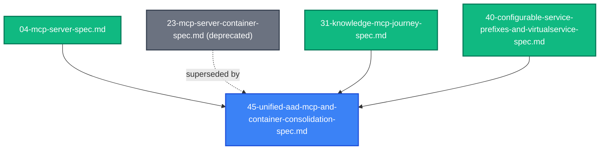

# Spec 45: Unified In-Process AAD MCP Server & Removal of `aad-mcp-container`

**Status**: `complete`

---

## Overview & Scope
This specification defines:
1. **Removal of the standalone `aad-mcp-container` microservice**, its separate Helm chart (`charts/agent-as-data-mcp`), FluxCD release (`fluxcd-dev/agent-as-data-mcp.yaml`), Makefile targets, and standalone MCP Docker publish workflow, establishing a clean **single-backend-per-repository** architecture (`aad-be-container`) consistent with `Graphrag` and `data-engine`.
2. **Unified In-Process AAD MCP Server (`aad_mcp.rs` + `aad_mcp_handler.rs`)** mounted directly on `aad-be-container`'s Axum router at `POST /mcp`, `POST {api_prefix}/mcp` (`/api/aad/v1/mcp`), and `POST /api/v1/mcp`, while preserving backward-compatible `POST {api_prefix}/knowledge/mcp` and `POST /api/v1/knowledge/mcp` routes.
3. **Internal Agent Tool Exposure (`llm_tools.rs` & `threads.rs`)**, wiring AAD platform capabilities directly into the workbench `rig` agent loop in-process via `AadMcpServer` (zero HTTP loopback, zero duplicated SQL logic).

---

## Dependencies & PRD References
- **PRD References**:
  - [Unified AAD MCP Server PRD](../prds/mcp-server-container-prd.md)
  - [Agent-As-Data Master PRD](../prds/agent-as-data-prd.md)
  - [Agent Registry & Execution PRD](../prds/agent-registry-execution-prd.md)
  - [Knowledge Base MCP Journey PRD](../prds/knowledge-mcp-journey-prd.md)
- **Supersedes**: [23-mcp-server-container-spec.md](./23-mcp-server-container-spec.md) (`deprecated`)

---

## 1. Container & Deployment Consolidation
- Delete `aad-mcp-container/`, `charts/agent-as-data-mcp/`, `fluxcd-dev/agent-as-data-mcp.yaml`, and `.github/workflows/aad-mcp-docker-publish.yml`.
- Update `fluxcd-dev/kustomization.yaml`, `fluxcd-dev/monitoring.yaml`, and `fluxcd-dev/virtualservice.yaml` (routing `/mcp` directly to `agent-as-data-be`).
- Update `Makefile`, `.github/workflows/ci.yml`, `.github/workflows/helm-ci-pr.yaml`, `.github/workflows/helm-ci-main.yaml`, `.github/workflows/integration-test.yaml`, `.github/workflows/cleanup-dev-packages.yml`, `AGENTS.md`, and `README.md`.
- Update `manifests/vars/{local,cluster-dev,istio-gateway}.yaml` and `manifests/ecosystem/tools/aad-mcp-server.yaml` so `AAD_MCP_URL` targets `aad-be-container` (`/api/aad/v1/mcp`).

---

## 2. Unified In-Process MCP Endpoints & Protocol Contract

Mounted in `aad-be-container/src/webserver/mod.rs`:
- `POST /mcp` (root alias)
- `POST {api_prefix}/mcp` (e.g., `POST /api/aad/v1/mcp`)
- `POST /api/v1/mcp` (backward-compatible alias)
- `POST {api_prefix}/knowledge/mcp` and `POST /api/v1/knowledge/mcp` (backward-compatible Knowledge MCP subset, upgraded to include JSON Schema `inputSchema` in `tools/list`)

Protocol methods supported via HTTP JSON-RPC 2.0:
- `initialize`: Returns `protocolVersion: "2024-11-05"`, `capabilities: { "tools": {} }`, `serverInfo: { "name": "aad-be-mcp", "version": "1.0.0" }`, and instructions.
- `notifications/initialized`: Returns `204 No Content` when notification (`id` omitted) or `{}` when called with an `id`.
- `ping`: Returns `{}`.
- `tools/list`: Returns all registered `rmcp` tools with auto-generated `schemars` `inputSchema` via `ToolRouter::list_all()`.
- `tools/call`: Validates `params.name` and `params.arguments`, invokes the corresponding `AadMcpServer` method, and returns `{ "content": [{ "type": "text", "text": "..." }], "isError": false|true }`.

### Exposed AAD MCP Tools

| Domain | Tool Names |
| :--- | :--- |
| **Agents Registry** | `list_agents`, `get_agent`, `search_agents`, `create_agent`, `update_agent`, `delete_agent` |
| **Skills Registry** | `list_skills`, `get_skill`, `create_skill`, `update_skill`, `delete_skill` |
| **Traits Registry** | `list_traits`, `get_trait`, `create_trait`, `update_trait`, `delete_trait` |
| **MCP Tools Registry** | `list_mcp_servers`, `get_mcp_server` |
| **Semantic Context Search** | `search_agent_context` |
| **Knowledge & Graph** | `search_knowledge`, `read_knowledge`, `ingest_knowledge`, `update_knowledge`, `delete_knowledge`, `traverse_knowledge_graph` |
| **Workbenches & Memory** | `list_benches`, `get_bench`, `list_threads`, `read_bench_memory`, `update_bench_memory` |
| **Execution** | `execute_agent`, `get_execution` |

---

## 3. Internal Workbench Agent Tool Exposure
To guarantee AAD workbench agents can also invoke AAD platform capabilities directly (without relying on external HTTP loopback):
- Expose in-process `rig::tool::Tool` implementations in `aad-be-container/src/llm_tools.rs` backed directly by `AadMcpServer`:
  - `ListAgentsTool` (`list_agents`)
  - `GetAgentTool` (`get_agent`)
  - `SearchAgentsTool` (`search_agents`)
  - `ListTraitsTool` (`list_traits`)
  - `ListMcpServersTool` (`list_mcp_servers`)
  - `SearchAgentContextTool` (`search_agent_context`)
  - `InvokeAadCapabilityTool` (`invoke_aad_capability` — generic dispatcher to any AAD MCP tool by name & JSON arguments, paired with `ListAadCapabilitiesTool` / `list_aad_capabilities`)
- Wire these tools into `threads.rs` agent construction and `execute_workspace_tool` dispatch.

---

## 4. Test Strategy & Verification Plan
1. **Unit & Router Tests (`make aad-be-test`)**:
   - Verify `POST /mcp`, `POST /api/aad/v1/mcp`, `POST /api/v1/mcp`, and `POST /api/aad/v1/knowledge/mcp` route cleanly (`200 OK` on `initialize`, `ping`, `tools/list`; `204 No Content` on `notifications/initialized`).
   - Verify `tools/list` returns every AAD capability tool with valid `inputSchema` objects.
   - Verify `tools/call` handles unknown tool names (`isError: true`), malformed arguments (`isError: true`), and missing `name` parameter (`-32602`).
   - Verify internal `rig` tools (`ListAgentsTool`, `SearchAgentsTool`, `ListTraitsTool`, `ListMcpServersTool`, `SearchAgentContextTool`, `ListAadCapabilitiesTool`, `InvokeAadCapabilityTool`) produce valid tool definitions and dispatch cleanly.
2. **Manifest & Chart Validation**:
   - Run `make validate-manifests` across `local.yaml`, `cluster-dev.yaml`, and `istio-gateway.yaml`.
   - Run `helm lint charts/agent-as-data`.
   - Run `python3 -m unittest integration-tests/lib/test_aad_requests.py`.
3. **Integration Tests (Robot Framework)**:
   - Update `test_journey_16_hams_telemetry.robot`, `AADRequests.py`, `test_aad_requests.py`, and `run-tests.sh` to remove references to the deleted `agent-as-data-mcp` service.
   - Add `integration-tests/tests/test_aad_mcp.robot` verifying `POST /api/aad/v1/mcp` handshake, tool discovery, and live tool execution.
