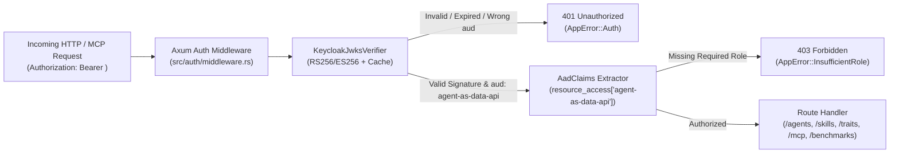

# Spec 46: Keycloak JWKS Authentication, `agent-as-data-api` Claims Gatekeeper & `agent-as-data-sa` Service Auth (`src/auth/`)

- **Status**: `draft`
- **Derived From**: [keycloak-claims-and-service-auth-prd.md](../prds/keycloak-claims-and-service-auth-prd.md)
- **Dependencies**: [09-backend-modular-architecture-spec.md](./09-backend-modular-architecture-spec.md), [40-configurable-service-prefixes-and-virtualservice-spec.md](./40-configurable-service-prefixes-and-virtualservice-spec.md), [45-unified-aad-mcp-and-container-consolidation-spec.md](./45-unified-aad-mcp-and-container-consolidation-spec.md)

---

## 1. Objective

Implement OIDC Bearer token verification via Keycloak JWKS and domain-specific claims enforcement across all Agent-As-Data REST endpoints (`/api/aad/v1/...`, `/api/v1/...`) and Unified MCP endpoints (`/mcp`, `/api/aad/v1/mcp`), with **zero dev/fake auth bypasses** in any environment.
1. **Resource Server Protection (`agent-as-data-api`)**: Validates OIDC Bearer tokens against cluster Keycloak JWKS.
2. **Domain-Specific Client Roles**: Enforces `agent:read`, `agent:author`, `agent:publish`, and `governance:admin` from `resource_access["agent-as-data-api"].roles`.
3. **Ecosystem Realm Groups Integration**: Compatible with roles granted via `DataAgentAdmins` and `DataAgentUsers` realm groups.
4. **Machine-to-Machine Integration (`agent-as-data-sa`)**: M2M service account authentication for automated CLI and orchestrator interactions.
5. **Fail-Closed Security**: Rejects unauthenticated or insufficiently authorized requests with `401 Unauthorized` or `403 Forbidden`.

---

## 2. Request Flow & Middleware Architecture



---

## 3. Configuration & Error Handling Contract

### 3.1 Modular Auth Configuration (`AuthConfig`)
Added to AAD's modular configuration (`AAD_BE__AUTH__*`, zero hardcoded runtime defaults, fail-fast `.validate()`):
```rust
#[derive(Debug, Clone, Deserialize, Serialize)]
pub struct AuthConfig {
    pub issuer_url: String,           // e.g. "http://keycloak-keycloakx-http.auth.svc.cluster.local/auth/realms/sw-dev"
    pub jwks_url: String,             // e.g. "http://keycloak-keycloakx-http.auth.svc.cluster.local/auth/realms/sw-dev/protocol/openid-connect/certs"
    pub expected_audience: String,    // default in config.yaml: "agent-as-data-api"
    pub jwks_cache_ttl_seconds: u64,  // default: 300 (must be > 0)
}
```
Validation rules:
- `issuer_url` must be a valid HTTP/HTTPS URL.
- `jwks_url` must be a valid HTTP/HTTPS URL.
- `expected_audience` must not be empty.
- `jwks_cache_ttl_seconds` must be `> 0`.
- Zero bypass or disable flags are permitted.

### 3.2 Typed Errors (`AppError` / `AuthError`)
- `AuthError::MissingBearerToken` $\rightarrow$ `401 Unauthorized`
- `AuthError::InvalidToken(String)` $\rightarrow$ `401 Unauthorized`
- `AuthError::JwksFetchFailed(String)` $\rightarrow$ `503 Service Unavailable`
- `AuthError::InsufficientRole { required: String }` $\rightarrow$ `403 Forbidden`

---

## 4. Claims Structure & Role Mapping

### 4.1 Token Claims Representation (`AadClaims`)
```rust
#[derive(Debug, Clone, Deserialize, Serialize)]
pub struct AadClaims {
    pub sub: String,
    pub iss: String,
    pub aud: Vec<String>,
    pub preferred_username: Option<String>,
    pub email: Option<String>,
    pub resource_access: HashMap<String, ClientRoles>,
    pub agent_as_data: Option<AadCustomClaims>,
}

#[derive(Debug, Clone, Deserialize, Serialize)]
pub struct AadCustomClaims {
    pub organization_id: String,
    pub publishing_tier: String,
    pub allowed_registries: Vec<String>,
}
```

### 4.2 Endpoint Role Gates
- `agent:read`:
  - `GET /api/v1/agents`, `GET /api/v1/skills`, `GET /api/v1/traits`, `GET /api/v1/tools`
  - `GET /api/v1/knowledge/*`
  - MCP tool discovery (`tools/list`) and read tools (`read_bench_memory`, etc.)
- `agent:author`:
  - `POST /api/v1/agents`, `POST /api/v1/skills`, `POST /api/v1/traits`
  - `POST /api/v1/benches`, `POST /api/v1/threads`
- `agent:publish`:
  - Promoting agents or skills to enterprise catalog (`publishing_tier = "enterprise"`).
- `governance:admin`:
  - `DELETE /api/v1/agents/*`, `DELETE /api/v1/skills/*`
  - Modifying guardrail policies and audit configurations.

---

## 5. Test Strategy

### 5.1 Unit Tests (`src/auth/`)
- Verify fail-fast `AuthConfig::validate()` prevents startup if URLs are invalid or empty.
- Verify JWT signature and issuer validation against cached JWKS.
- Verify role extraction from `resource_access["agent-as-data-api"].roles`.
- Verify extraction of `agent_as_data` claims namespace.

### 5.2 Integration Tests (`integration-tests/`)
- Verify that calls without `Authorization` header receive `401 Unauthorized`.
- Verify requests with `DataAgentAdmins` tokens succeed across all endpoints.
- Verify requests with `DataAgentUsers` tokens succeed on author/read endpoints and fail with `403 Forbidden` on admin/governance endpoints.
